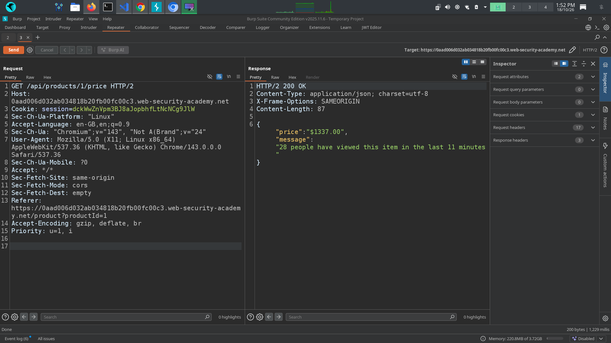
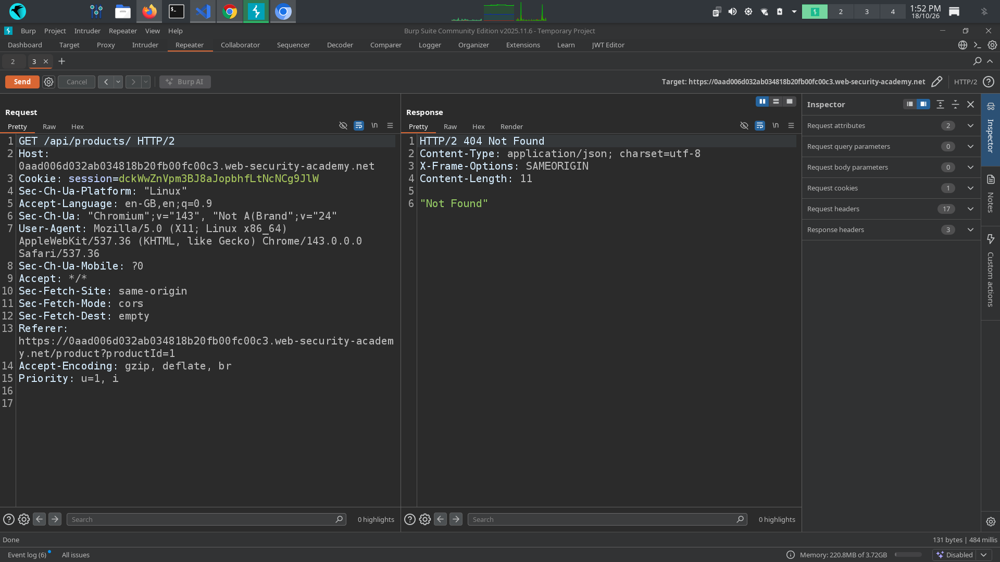
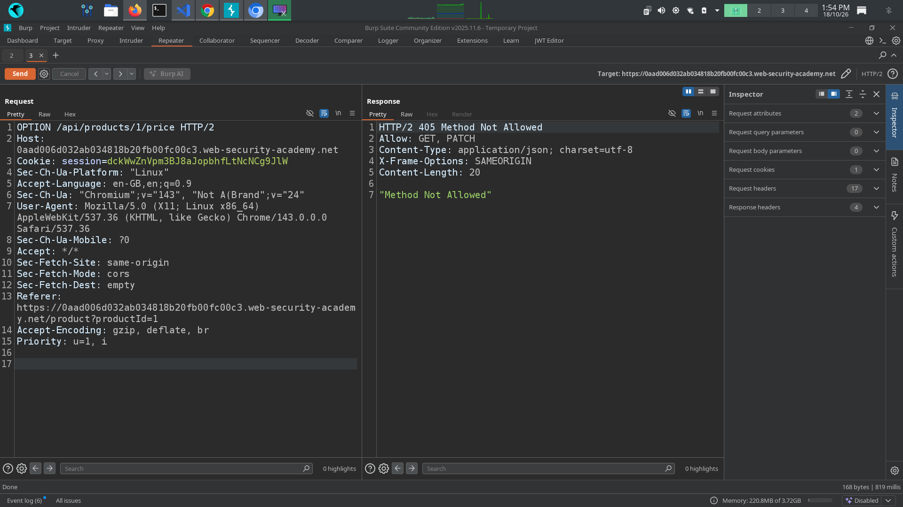
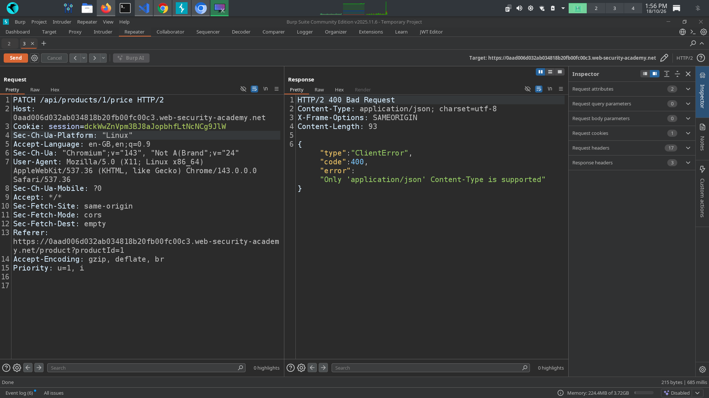
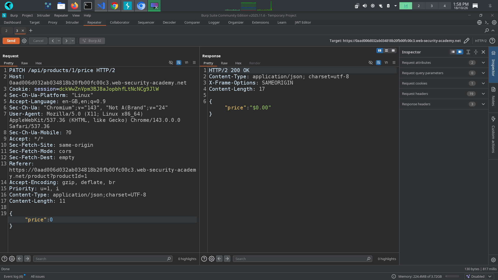
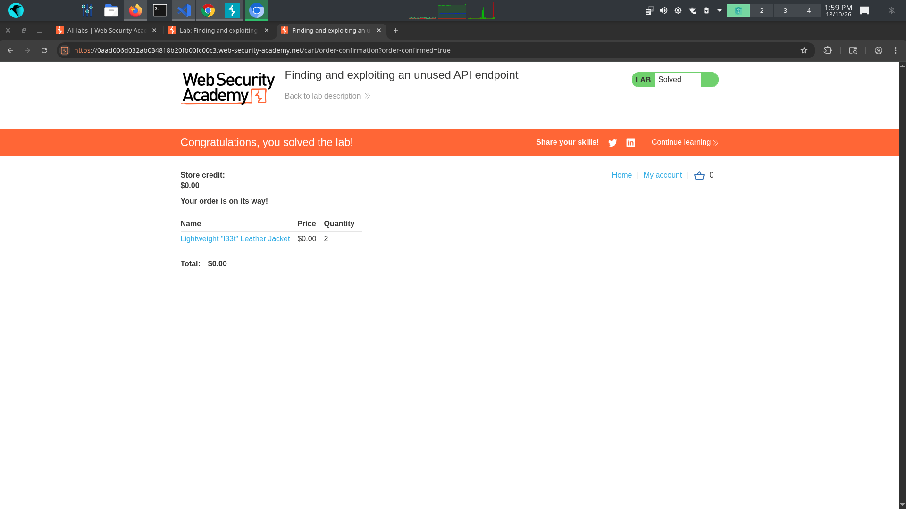

# 📌 Lab: Finding and Exploiting an Unused API Endpoint

**Difficulty:** Practitioner  
**Status:** Solved

---

## 📌 Lab Overview

This PortSwigger Web Security Academy lab focuses on finding and exploiting an unused API endpoint to purchase the Lightweight l33t Leather Jacket.

I logged in using the provided credentials and inspected the application's requests in Burp Suite. During testing, I discovered a product price API endpoint that returned information in JSON format. By testing different HTTP methods and analyzing the server's error messages, I found that the endpoint accepted a `PATCH` request to modify the product price.

I changed the price to zero, returned to the product page, and successfully placed the order.

## 🛠️ Tools Used

- Burp Suite Community Edition
- PortSwigger Web Security Academy
- Burp Proxy
- Burp Repeater
- Content-Type Converter extension

---

## 🚨 Vulnerability

**Unused API Endpoint and Missing Authorization**

The application exposed an API endpoint that allowed product-price modification through a `PATCH` request.

During testing, I identified the following issues:

1. Sending an `OPTIONS` request and analyzing the server's response helped me identify the supported HTTP methods.
2. Sending a `PATCH` request revealed that the request body needed to be in JSON format.
3. The application allowed the product price to be modified without properly restricting this sensitive operation to authorized users.
4. After changing the price to zero, I was able to purchase the jacket successfully.

The main security issue was insufficient authorization for modifying a sensitive product property.

---

## 🎯 Affected Functionality

The affected functionality was the product price API endpoint, which supported retrieving product information and modifying the price.

The application did not properly restrict the price-modification operation, allowing an authenticated user to change the product price through a manually crafted API request.

---

## 🔍 Root Cause

The root cause was insufficient server-side authorization for a sensitive API operation.

The application exposed a `PATCH` method that allowed product-price modification without adequately verifying whether the user had permission to perform that action.

The server's error messages also revealed useful information about the supported HTTP methods and expected request format. These messages helped me discover the endpoint's functionality, but the main vulnerability was the missing authorization control.

---

## 🧪 Testing Steps

### Step 1: Log in and inspect API requests

First, I logged in using the credentials provided by the lab. I opened the Lightweight l33t Leather Jacket product page, clicked **Add to Cart**, and inspected the generated requests in Burp Suite.

While reviewing the requests, I found a `GET` request to the product price API endpoint that returned the response in JSON format. I sent this request to Burp Repeater for further testing.

### Step 2: Try removing request fields

I tried removing individual fields from the request to understand the endpoint's behavior and check whether I could discover additional functionality or documentation.

However, removing the fields did not produce the expected results.

### Step 3: Test the OPTIONS method

Next, I changed the HTTP method to `OPTIONS` and sent the request through Burp Repeater.

The server's error response indicated that only `PATCH` and `GET` methods were allowed. This gave me a clue that the endpoint supported additional functionality beyond retrieving product information.

### Step 4: Send a PATCH request

Based on the previous response, I changed the request method to `PATCH` and sent it again.

The server returned an error indicating that the request body needed to be in JSON format. This helped me identify the expected request format.

### Step 5: Modify the product price

I used the Content-Type Converter extension to convert the request body into JSON format. Then, I changed the product price to `0` and sent the modified request.

The server accepted the change. When I returned to the product page, I confirmed that the jacket's displayed price had changed to zero.

### Step 6: Place the order and solve the lab

After changing the price, I returned to the jacket's product page, added it to the cart, and proceeded to checkout.

The order was placed successfully, and the lab was marked as solved.

---

## 💥 Impact

If a similar vulnerability existed in a real application, an attacker might be able to:

- Modify product prices without authorization.
- Purchase products at unauthorized prices.
- Cause financial losses to the business.
- Manipulate other sensitive product information if similar authorization weaknesses existed.

The actual impact would depend on the endpoint's permissions and the data it allowed users to modify.

---

## 🛡️ Remediation

1. **Implement proper authorization:** Restrict product-price modifications to authorized administrators or product-management roles.
2. **Protect sensitive properties:** Prevent ordinary users from modifying prices, discounts, and inventory quantities.
3. **Maintain an API inventory:** Document all API endpoints, supported HTTP methods, versions, and access permissions.
4. **Remove unused endpoints:** Disable endpoints that are no longer needed.
5. **Validate request data:** Enforce request schemas, field allowlists, data types, and business rules.
6. **Test authorization controls:** Verify that users cannot perform privileged operations by changing HTTP methods or manually crafting requests.
7. **Monitor sensitive changes:** Log product-price modifications and investigate suspicious activity.

---

## 📚 OWASP / CWE Reference

- **OWASP API Security Top 10 2023 — API5: Broken Function Level Authorization:** Relevant if the price-modification function is privileged but accessible to users without the required permissions.
- **OWASP API Security Top 10 2023 — API9: Improper Inventory Management:** Relevant to the broader risk of undocumented or poorly managed API endpoints remaining exposed.
- **CWE-862: Missing Authorization:** Relevant when an application fails to verify whether a user is authorized to perform a sensitive operation.

The most direct classification is Broken Function Level Authorization if the endpoint exposes a privileged function without the required permission checks. Improper Inventory Management relates to the broader risk of unmanaged API endpoints.

---

## 🧠 What I Learned

- How to inspect API requests and responses using Burp Suite.
- How testing HTTP methods such as `OPTIONS` and `PATCH` can reveal additional API functionality.
- How server error messages can help identify supported methods and expected request formats.
- How to modify and resend requests using Burp Repeater.
- Why authentication alone is not enough to protect sensitive API operations.
- Why product prices and other business-critical properties require server-side authorization.
- Why maintaining an accurate API inventory helps reduce the application's attack surface.

