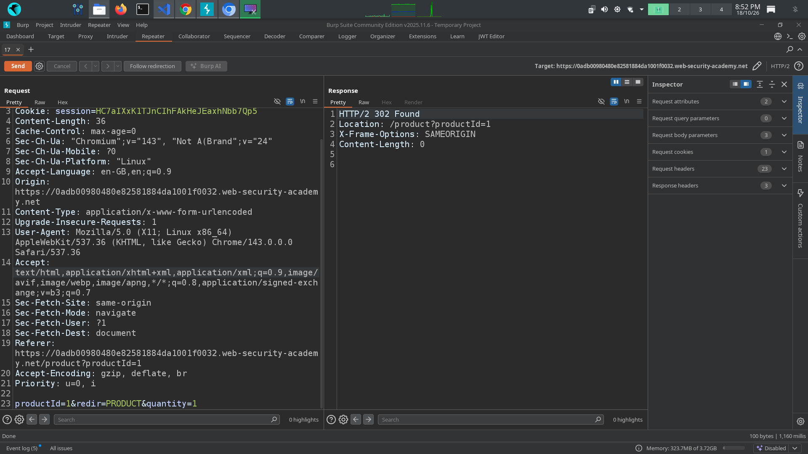
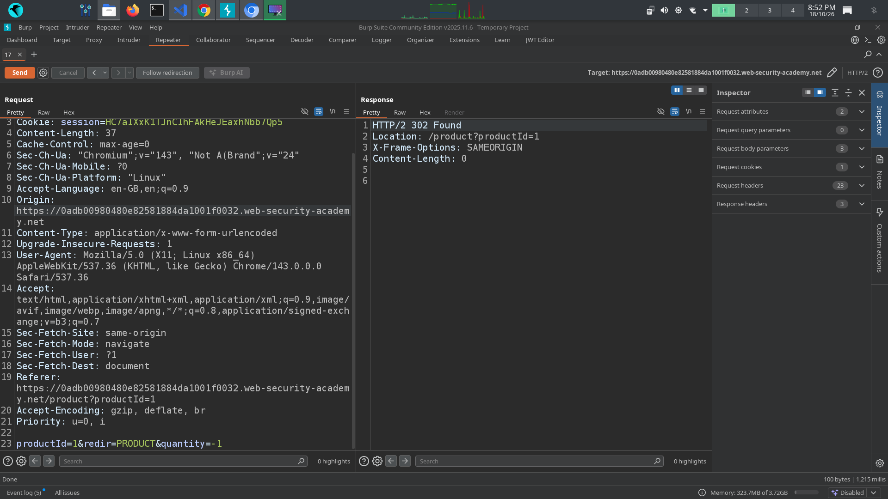
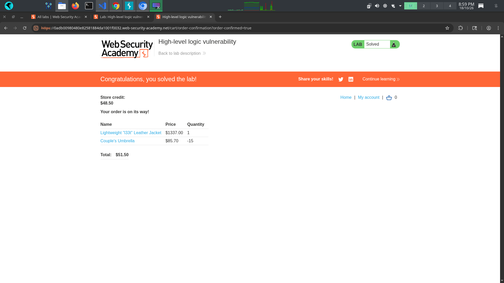

# 📌 Lab: High-Level Logic Vulnerability

**Difficulty:** Apprentice  
**Status:** Solved

---

## 📌 Lab Overview

This PortSwigger Web Security Academy lab demonstrates a business logic vulnerability caused by insufficient validation of user input.

The application allows users to manipulate product quantities during the purchasing process. By submitting a negative quantity, I was able to exploit the purchasing workflow and buy the Lightweight l33t Leather Jacket for an unintended price.

The lab highlights why applications must enforce business rules and validate user-controlled values on the server side.

## 🛠️ Tools Used

- Burp Suite Community Edition
- PortSwigger Web Security Academy
- Burp Proxy
- Burp Repeater

---

## 🚨 Vulnerability

**Business Logic Vulnerability — Improper Quantity Validation**

The application did not properly validate the product quantity submitted during the purchasing process.

During testing, I discovered that:

1. The product quantity could be modified by intercepting and changing the request in Burp Suite.
2. The application accepted negative integer values for the product quantity instead of rejecting them.
3. By manipulating the quantities of products in the cart, I could exploit the purchasing workflow to buy the target jacket for an unintended price.

This vulnerability occurred because the application failed to enforce the expected business rules on the server side.

---

## 🎯 Affected Functionality

- Add-to-cart functionality
- Product quantity handling
- Shopping cart price calculation
- Order placement and checkout

## 🔍 Root Cause

The root cause was insufficient server-side validation of product quantities.

1. The application did not reject negative quantity values submitted by the user.
2. The purchasing workflow did not properly enforce the business rule that product quantities must be valid positive integers.
3. The application relied on input values that could be manipulated by modifying HTTP requests.

As a result, an attacker could submit unexpected values and manipulate the purchasing workflow to obtain products at an unintended price.

---

## 🧪 Testing Steps

### Step 1: Log in and inspect the cart request

First, I logged in using the credentials provided by the lab. I navigated to the Lightweight l33t Leather Jacket product page and clicked **Add to Cart**.

I then opened Burp Suite and inspected the `POST /cart` request to understand how the application submitted product and quantity information.

### Step 2: Modify the product quantity

I sent the request to Burp Repeater and modified the quantity attribute.

During testing, I discovered that the application accepted a negative integer as the product quantity instead of rejecting the request.

This indicated that the server was not properly validating the submitted quantity against the application's business rules.

### Step 3: Exploit the purchasing workflow

After confirming that negative quantities were accepted, I manipulated the quantities of products in the cart. I set another product's quantity to a negative value and kept the Lightweight l33t Leather Jacket quantity at `1`.

I then proceeded to checkout and placed the order. The application accepted the order, and the lab was successfully solved.

---

## 💥 Impact

In a real-world application, this vulnerability could allow an attacker to manipulate the purchasing process and obtain products at unintended prices.

Potential impacts include:

- Financial losses due to incorrect order totals.
- Manipulation of shopping cart calculations.
- Abuse of discounts, refunds, or inventory calculations if similar validation flaws exist.
- Unauthorized financial benefits through invalid product quantities.

The actual impact depends on how the application calculates prices and processes orders.

## 🛡️ Remediation

1. **Validate quantities on the server side:** Reject negative quantities, zero quantities where inappropriate, and invalid data types.
2. **Enforce business rules:** Ensure that product quantities are valid positive integers before adding items to the cart or processing an order.
3. **Recalculate prices on the server:** Never trust prices or totals supplied by the client. Calculate the final order total using trusted product and pricing data.
4. **Validate the complete cart:** Check every product quantity and the final order total before accepting checkout.
5. **Use consistent validation:** Apply the same business rules across cart updates, checkout, and order-processing endpoints.
6. **Add automated tests:** Test negative quantities, zero values, unusually large quantities, and combinations of cart items.
7. **Maintain inventory integrity:** Ensure that cart manipulation cannot create invalid stock levels or inconsistent order records.

---

## 📚 OWASP / CWE Reference

- **CWE-840: Business Logic Errors** — Relevant to flaws in an application's business rules and workflow.
- **CWE-20: Improper Input Validation** — Relevant because the application accepts invalid quantity values without adequate validation.
- **OWASP API Security Top 10 2023 — API3: Broken Object Property Level Authorization:** Not the primary classification for this lab; the issue concerns quantity validation and business logic rather than unauthorized access to a protected object property.

The primary finding is a business logic flaw caused by accepting negative product quantities.

---

## 🧠 What I Learned

- What business logic vulnerabilities are and how they differ from traditional injection vulnerabilities.
- How to inspect and modify HTTP requests using Burp Suite.
- How client-submitted values can be manipulated when server-side validation is missing.
- Why product quantities must follow valid business rules.
- Why applications must calculate prices and order totals on the server side.
- How unexpected input values can affect the purchasing workflow and lead to financial impact.

