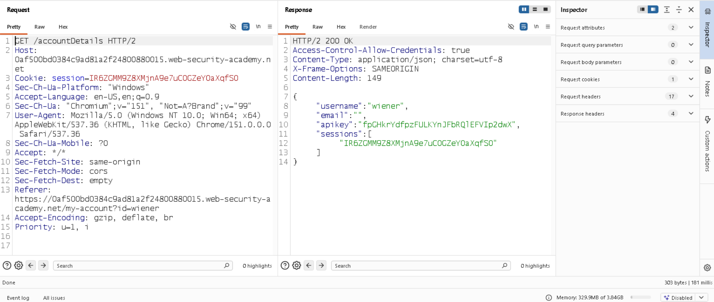
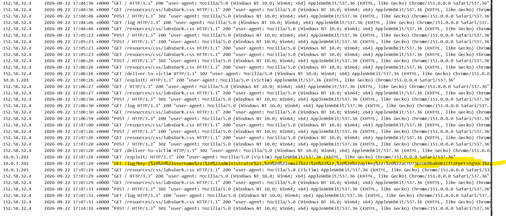

# 📌 Lab: CORS Vulnerability with Trusted `null` Origin

**Difficulty:** Practitioner

**Status:** Solved

---

## 📌 Lab Overview

This lab contains a **Cross-Origin Resource Sharing (CORS) misconfiguration** where the application trusts the `null` origin and allows credentialed cross-origin requests.

The application returns sensitive account information through the `/accountDetails` endpoint. Because the server trusts the `null` origin, an attacker-controlled page can make a cross-origin request and read the response using the victim's authenticated session.

The objective was to retrieve the administrator's API key and submit it to complete the lab.

---

## 🛠️ Tools Used

- Burp Suite Community Edition
- PortSwigger Web Security Academy
- Browser Developer Tools
- PortSwigger Exploit Server

---

## 🚨 Vulnerability

1. The application allows cross-origin requests from the `null` origin.

2. The server returns `Access-Control-Allow-Credentials: true`, allowing credentialed CORS requests.

3. This combination allows a specially crafted page with a `null` origin to read sensitive responses from the application when the victim's browser includes valid credentials.

---

## 🎯 Affected Functionality

The affected functionality is the **Account Details** endpoint:

`/accountDetails`

This endpoint returns sensitive account information, including the API key, to authenticated users.

---

## 🔍 Root Cause

1. The server incorrectly trusts the `null` origin instead of restricting access to a strict list of trusted origins.

2. The application allows credentialed cross-origin requests by returning `Access-Control-Allow-Credentials: true`.

3. The server does not adequately restrict which origins can read sensitive account information through browser-based cross-origin requests.

---

## 🧪 Testing Steps

### 1. Inspecting the Account Details Response

First, I logged in using the credentials provided by the lab:

```text
Username: wiener
Password: peter
```

I navigated to the Account Details functionality and inspected the HTTP response using Burp Suite.

The response contained the following header:

```http
Access-Control-Allow-Credentials: true
```

This indicated that the server permitted credentialed CORS requests when the other CORS requirements were satisfied.

**Evidence:**



### 2. Testing the Origin Header

Next, I modified the `Origin` header in the request to test the application's CORS configuration.

I first used an external origin:

```http
Origin: https://www.google.com
```

The application did not authorize this origin to read the sensitive response.

I then changed the header to:

```http
Origin: null
```

The server returned the following headers:

```http
Access-Control-Allow-Origin: null
Access-Control-Allow-Credentials: true
```

This confirmed that the application trusted the `null` origin while allowing credentialed cross-origin access.

**Evidence:**


### 3. Creating a Page with a Null Origin

After confirming the misconfiguration, I used a sandboxed iframe on the PortSwigger exploit server.

An iframe sandboxed without the `allow-same-origin` permission receives an opaque origin, which is serialized as `null` in relevant browser requests.

The page used JavaScript to request the `/accountDetails` endpoint and read the response.

The request included credentials using:

```javascript
req.withCredentials = true;
```

Because the application trusted the `null` origin and the browser's credential and cookie policies permitted the request, the response could be read by the exploit page.

### 4. Exploiting the CORS Misconfiguration

I hosted the exploit on the PortSwigger exploit server.

The exploit followed these steps:

1. Create a sandboxed iframe with a `null` origin.
2. Send a credentialed request to `/accountDetails`.
3. Read the response using JavaScript.
4. Forward the response to the exploit server's access logs.

The target lab URL and exploit-server URL were specific to my lab instance.

**Evidence:**



### 5. Retrieving the Administrator's API Key

After executing the exploit, I checked the exploit server's access logs and retrieved the response containing the sensitive account information.

I used the administrator's API key as required by the lab.

The key was successfully retrieved, and the lab was completed.

---

## 💥 Impact

A successful CORS misconfiguration can allow an attacker to:

1. Read sensitive information from a cross-origin response.
2. Access account details using an authenticated victim's browser session.
3. Expose API keys, personal information, or other confidential data returned by vulnerable endpoints.
4. Combine the misconfiguration with an attacker-controlled webpage to steal information without directly accessing the victim's session cookie.

In this lab, the demonstrated impact was the retrieval of the administrator's API key.

---

## 🛡️ Remediation

1. **Use a strict origin allowlist:** Allow only explicitly trusted origins rather than trusting `null` or reflecting arbitrary origins.

2. **Restrict credentialed CORS requests:** Return `Access-Control-Allow-Credentials: true` only when cross-origin access with credentials is required.

3. **Protect sensitive endpoints:** Ensure account details and API keys are accessible only to authorized users and trusted application origins.

4. **Validate CORS configuration consistently:** Apply the same origin-validation rules across all endpoints that return sensitive data.

5. **Avoid exposing unnecessary information:** Return only the account information required by the client.

6. **Test browser behavior:** Verify that untrusted origins cannot read sensitive responses under the application's actual cookie and credential policies.

---

## 📚 OWASP / CWE Reference

- **OWASP:** Security Misconfiguration
- **CWE-942:** Permissive Cross-domain Policy with Untrusted Domains
- **CWE-284:** Improper Access Control

---

## 🧠 What I Learned

1. **CORS** controls whether browser-based JavaScript can read responses from a different origin.

2. The `Access-Control-Allow-Origin` header specifies which origin is permitted to read the response.

3. The `Access-Control-Allow-Credentials: true` header permits credentialed CORS access when the browser and other CORS requirements allow it.

4. A sandboxed iframe without `allow-same-origin` can generate a `null` origin.

5. Trusting the `null` origin can expose sensitive data when combined with credentialed cross-origin access.

6. CORS is not a replacement for authentication or authorization. Sensitive endpoints must still enforce proper access controls.

