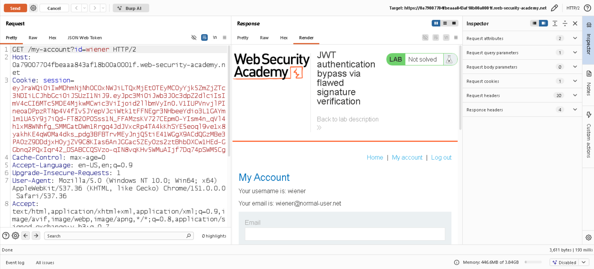
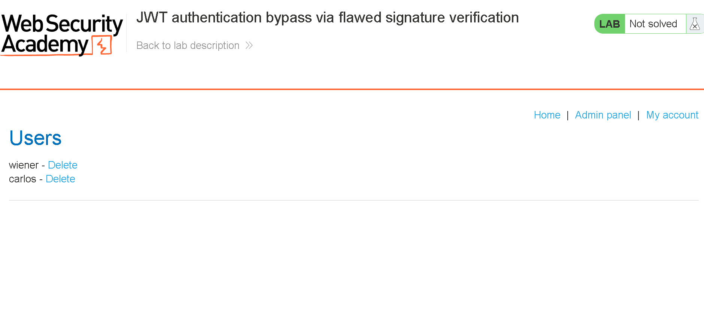
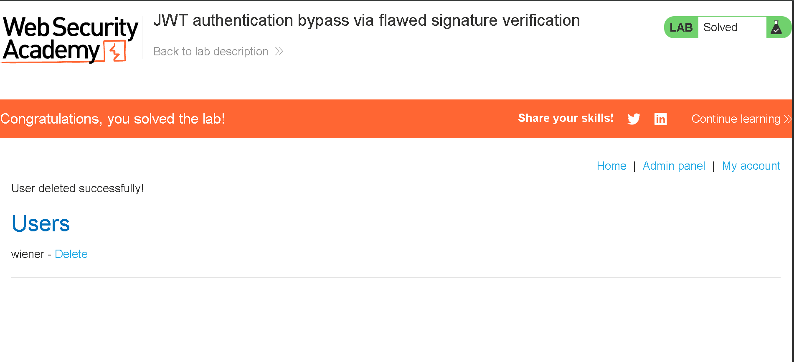

# 📌 Lab: JWT Authentication Bypass via `alg: none`

**Difficulty:** Practitioner

**Status:** Solved

---

## 📌 Lab Overview

This lab demonstrates a **JWT Authentication Bypass** vulnerability caused by improper validation of the JWT signing algorithm.

The application uses a JSON Web Token (JWT) to manage authenticated sessions. However, the server accepts an unsigned JWT with the `alg: none` header value.

The objective was to modify the JWT to impersonate the `administrator` user, access the `/admin` panel, and delete the `carlos` user.

---

## 🛠️ Tools Used

- Burp Suite Community Edition
- PortSwigger Web Security Academy
- Browser Developer Tools / JWT decoder

---

## 🚨 Vulnerability

1. The application uses a JWT to identify authenticated users.

2. The server does not properly enforce the expected signing algorithm and accepts an unsigned token.

3. An attacker can modify JWT claims, such as the username, and potentially gain unauthorized access to privileged functionality.

---

## 🎯 Affected Functionality

The affected functionality includes the **JWT-based session authentication mechanism** and the administrator panel available at `/admin`.

---

## 🔍 Root Cause

1. The application does not strictly enforce the expected JWT signing algorithm.

2. The server accepts tokens using `alg: none` without requiring a valid cryptographic signature.

3. The application trusts the modified username claim, allowing an attacker to impersonate the administrator.

---

## 🧪 Testing Steps

### 1. Logging In and Inspecting the JWT

First, I logged in to the application using the provided credentials:

```text
Username: wiener
Password: peter
```

After logging in, I inspected the HTTP requests and found a `session` cookie containing a JWT.

I decoded the token and examined its header and payload. The header specified the `RS256` signing algorithm, and the payload identified the authenticated user as `wiener`.

**Evidence:**



### 2. Modifying the JWT

Next, I modified the JWT header and payload.

- Changed the username claim from `wiener` to `administrator`.
- Changed the algorithm header from `RS256` to `none`.
- Removed the signature from the modified token.

The modified JWT no longer had a valid cryptographic signature.

**Evidence:**


### 3. Accessing the Administrator Panel

I sent a request to `/admin` using the modified JWT in the `session` cookie.

The server accepted the unsigned token and granted access to the administrator panel.

This confirmed that the application was vulnerable to JWT authentication bypass through improper algorithm validation.

**Evidence:**



### 4. Deleting the User

After gaining administrator access, I used the administrator panel to delete the `carlos` user.

The action was successful, and the lab was completed.

**Evidence:**



---

## 💥 Impact

A successful JWT authentication bypass can allow an attacker to:

1. Impersonate another user by modifying trusted JWT claims.
2. Bypass authentication if the server accepts unsigned tokens.
3. Escalate privileges from a regular user to an administrator.
4. Access sensitive functionality and perform unauthorized actions.

In this lab, the demonstrated impact was administrator access and the ability to delete another user.

---

## 🛡️ Remediation

1. **Enforce a fixed signing algorithm:** Configure the server to accept only explicitly approved algorithms instead of trusting the token's `alg` header.

2. **Verify JWT signatures:** Reject unsigned tokens and tokens with invalid signatures.

3. **Validate claims:** Verify relevant claims, including issuer (`iss`), audience (`aud`), and expiration (`exp`), as appropriate for the application.

4. **Apply server-side authorization:** Check the authenticated user's permissions for every privileged operation instead of relying only on a user-controlled claim.

5. **Use a trusted JWT library:** Follow secure configuration guidance and keep the library updated.

---

## 📚 OWASP / CWE Reference

- **OWASP:** Authentication and authorization weaknesses involving JWTs
- **CWE-347:** Improper Verification of Cryptographic Signature
- **CWE-287:** Improper Authentication

---

## 🧠 What I Learned

1. A **JSON Web Token (JWT)** contains a header, payload, and signature, separated by dots.

2. The JWT header specifies the signing algorithm, but the server must not blindly trust the algorithm provided by the token.

3. The `alg: none` technique can bypass authentication when an application incorrectly accepts unsigned tokens.

4. Modifying a JWT payload does not produce a valid signed token. The vulnerability occurs when the server fails to enforce signature verification.

5. Authentication and authorization must both be enforced server-side to prevent privilege escalation.

