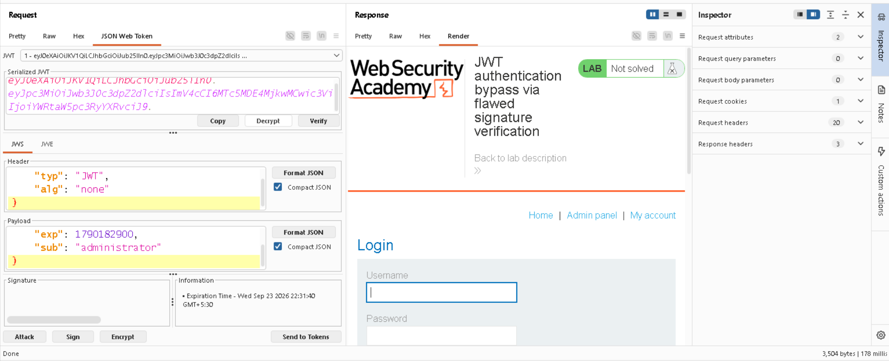

# JWT Authentication Bypass via `alg: none`

**Platform:** PortSwigger Web Security Academy  
**Vulnerability:** JWT Authentication Bypass  
**Impact:** Authentication Bypass / Privilege Escalation

## Objective

Gain access to the administrator panel at `/admin` and delete the user `carlos` by exploiting improper JWT signature validation.

## Exploitation

I first logged in using the provided credentials:

`wiener:peter`

After login, I inspected the request and found a `session` cookie containing a JWT.

The JWT header contained the `RS256` algorithm. I decoded the token and modified the payload, changing the user from `wiener` to `administrator`.

I then changed the JWT algorithm from `RS256` to `none` and removed the signature.

The modified token was sent to `/admin`. The server accepted the unsigned JWT and granted administrator access.

Using the administrator panel, I deleted the `carlos` user and successfully completed the lab.

## Root Cause

The application fails to properly validate the JWT signing algorithm and accepts tokens using `alg: none`. This allows an attacker to modify trusted JWT claims without providing a valid cryptographic signature.

## Impact

An attacker can potentially bypass authentication, impersonate users, or escalate privileges depending on which JWT claims the application trusts.

## Key Takeaway

JWT authentication must enforce an expected signing algorithm and verify the cryptographic signature before trusting any claims supplied in the token.