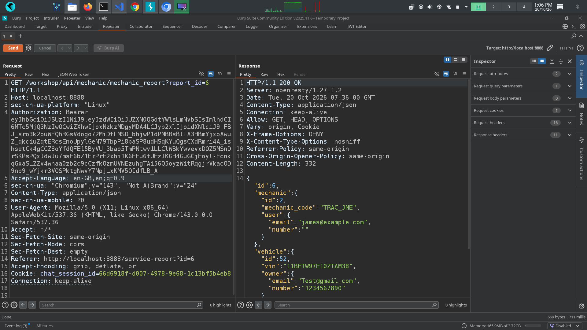
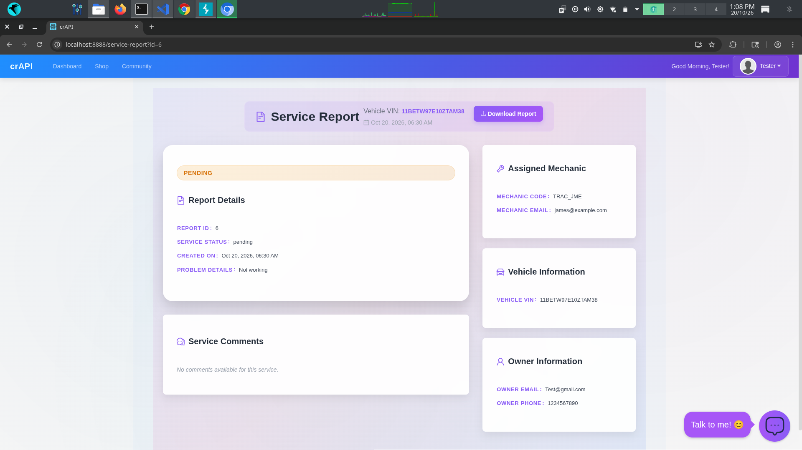
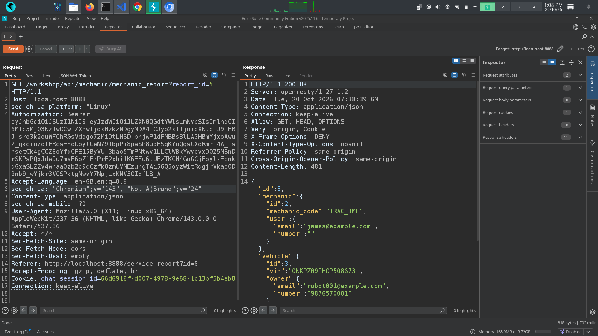
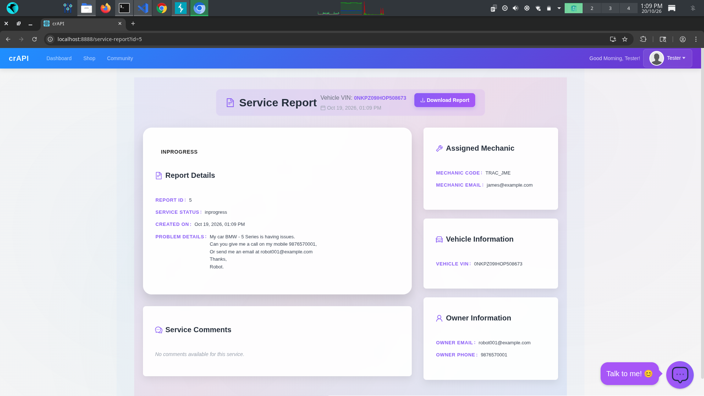

# Finding 01: IDOR in Vehicle Service Reports

## 1. Finding Overview

- **Vulnerability:** Insecure Direct Object Reference (IDOR)
- **OWASP Mapping:** API1:2023 — Broken Object Level Authorization (BOLA)
- **Affected Functionality:** Vehicle Service History / View Service Report
- **Severity:** Potentially High (subject to verification)
- **Environment:** Local OWASP crAPI lab

## 2. Summary

During testing of the crAPI application, I found that changing the service report ID in the URL from `6` to `5` returned information associated with another service report.

The response included vehicle owner email addresses, phone numbers, VINs, and assigned mechanic details. This suggests that the API may not properly verify whether the authenticated user is authorized to access the requested report.

## 3. Testing Methodology

1. Registered a Hyundai Creta using the VIN and PIN provided through MailHog.
2. Selected an available mechanic and submitted a service request.
3. Opened Vehicle Service History and viewed my service report.
4. Captured the request and identified the service report ID (`6`).
5. Changed the ID to `5` and inspected the response.
6. Observed information associated with another record.

## 4. Observed vs. Expected Behavior

**Observed:** Changing the report ID returned another record's information, including sensitive vehicle owner and mechanic details.

**Expected:** The server should verify the user's authorization for the requested report and deny access when the user is not permitted to view it.

## 5. Security Impact

If cross-user access is confirmed, an authenticated user could access other users' service report information by modifying report identifiers. This could expose personal contact details and vehicle-related information.

## 6. Root Cause

The suspected root cause is missing or insufficient object-level authorization. The API may validate authentication without checking whether the user has permission to access the specific report.

Further testing or source-code review is needed to confirm the exact implementation flaw.

## 7. Recommended Remediation

- Enforce server-side authorization for every service report request.
- Verify that the authenticated user is permitted to access the requested report.
- Restrict database queries to records the user is authorized to view.
- Add automated tests for unauthorized cross-user access.
- Return only the information required by the application.

## 8. Evidence

**Evidence 1: Normal access to the vehicle service report**

&#x20;   \
&#x20;   \

**Evidence 2: Access after modifying the service report ID**

&#x20;\
&#x20;\

## 9. Retesting Status

**Status:** Not yet retested after remediation.

The issue should be retested after implementing the authorization fix to confirm that unauthorized users cannot access other users' reports.

## 10. What I Learned

This test demonstrated the difference between authentication and authorization. A valid login token does not mean a user should have access to every resource. APIs must enforce object-level authorization on the server for each protected request.