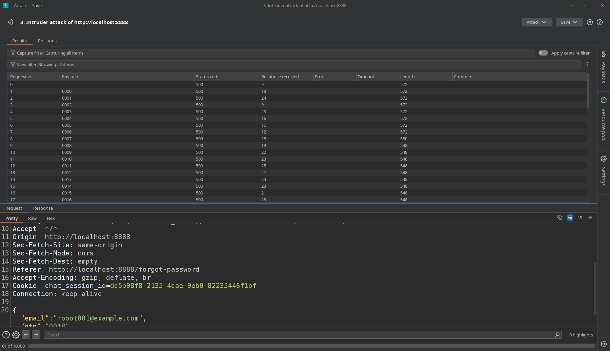

# Finding 02: Password Reset Rate-Limit Bypass via Legacy API Version

## 1. Finding Overview

- **Vulnerability:** OTP Rate-Limit Bypass
- **OWASP Mapping:** API2:2023 — Broken Authentication
- **Affected Functionality:** Forgot Password / OTP Verification / Password Reset
- **Severity:** Potentially High (subject to verification)
- **Environment:** Local OWASP crAPI lab

## 2. Summary

During testing of the crAPI application, I found that repeated OTP attempts against API version `v3` triggered server-side restrictions. Changing the endpoint version to `v2` allowed the attempts to continue, and I was able to reset another test account's password and log in.

This indicates that security controls may not be consistently enforced across API versions.

## 3. Testing Methodology

1. Obtained another test account's email address during an earlier IDOR test.
2. Opened the Forgot Password workflow and submitted the email address.
3. Intercepted the OTP verification request using Burp Suite.
4. Observed server-side restrictions when testing OTP attempts against API version `v3`.
5. Changed the API version in the request URL from `v3` to `v2`.
6. Retested the OTP verification request and observed different behavior.
7. Successfully identified the OTP and reset the target test account's password.
8. Logged in with the updated password and verified access to the account.

## 4. Observed vs. Expected Behavior

**Observed:** The legacy API endpoint appeared to handle repeated OTP attempts differently, allowing the OTP to be discovered and the target account's password to be reset.

**Expected:** All supported API versions should enforce consistent OTP verification, attempt limits, and rate-limiting controls.

## 5. Security Impact

An attacker could potentially bypass OTP attempt restrictions, reset another user's password, and gain unauthorized access to their account. Successful account access was demonstrated in the local test environment.

## 6. Root Cause

The suspected root cause is inconsistent enforcement of OTP security controls across API versions. The legacy endpoint may lack the rate limits or verification protections applied by the newer endpoint.

Further testing or source-code review is needed to confirm the exact implementation flaw.

## 7. Recommended Remediation

- Enforce consistent OTP rate limits across all supported API versions.
- Disable legacy endpoints that are no longer required.
- Implement OTP expiration, attempt limits, and temporary lockouts.
- Invalidate OTPs after successful verification.
- Add automated tests to ensure legacy endpoints cannot bypass authentication controls.

## 8. Evidence

**Evidence 1: OTP verification using API version 3**

&#x20;   

**Evidence 2: OTP verification using API version 2**

&#x20;   

**Evidence 3: Successful password reset**

&#x20;   

**Evidence 4: Login after password reset**

&#x20;   

## 9. Retesting Status

**Status:** Not yet retested after remediation.

The issue should be retested after applying consistent OTP protections to confirm that changing API versions cannot bypass rate limits or enable unauthorized password resets.

## 10. What I Learned

This test demonstrated that security controls must be consistently enforced across API versions. A protected endpoint does not provide adequate security if a legacy endpoint exposes the same functionality without equivalent protections.