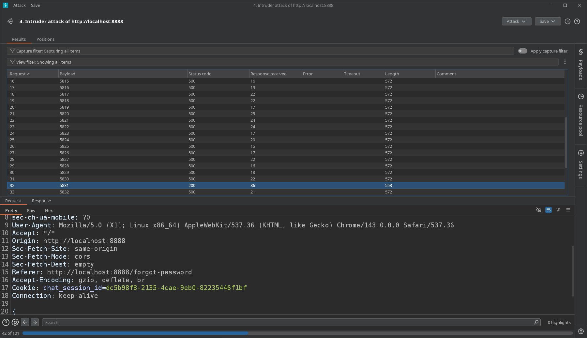
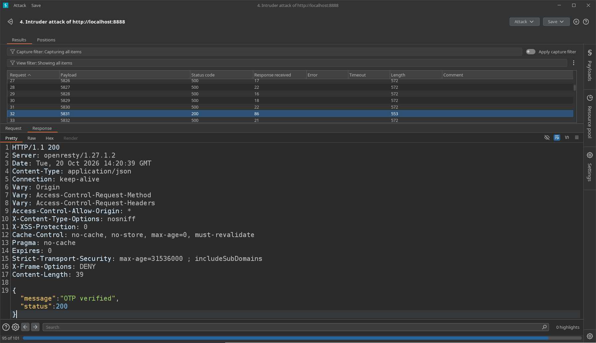
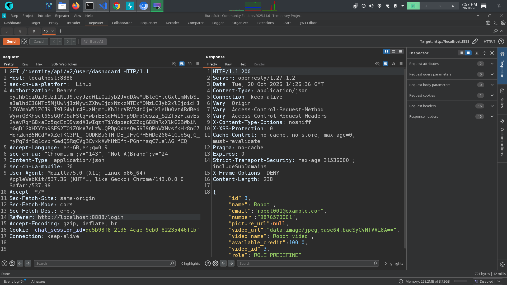

# Password Reset Rate-Limit Bypass via Legacy API Version

## 1. Lab Overview
This assessment identified a potential authentication vulnerability in the password-reset workflow. The application’s newer OTP verification endpoint appeared to enforce request restrictions, while changing the API version from `v3` to `v2` allowed OTP brute-force testing to continue and ultimately enabled a password reset for another user account.

## 2. Tools Used
- Burp Suite
- Browser Developer Tools
- crAPI local testing environment

## 3. Vulnerability
**Category:** Authentication / OTP Rate-Limit Bypass  
**Related weakness:** Inconsistent security controls across API versions  
**OWASP Mapping:** OWASP API Security Top 10 2023 — API2: Broken Authentication  
**Additional consideration:** API inventory and legacy-version management

## 4. Affected Functionality
- Forgot Password
- OTP Verification
- Password Reset
- Legacy OTP verification endpoint (`v2`)

## 5. Root Cause
The legacy API version appeared to lack, or inconsistently enforce, the OTP verification restrictions applied by the newer endpoint. This allowed repeated OTP attempts through the older route and ultimately permitted an unauthorized password reset.

The exact backend cause should be confirmed through code review or controlled retesting.

## 6. Testing Steps
1. Identified another test account’s email address during an earlier object-level authorization test.
2. Opened the Forgot Password workflow and submitted the identified email address.
3. Intercepted the OTP verification request using Burp Suite.
4. Observed that repeated OTP attempts against the newer API endpoint triggered server-side restrictions.
5. Changed the API version in the request URL from `v3` to `v2`.
6. Retested the OTP verification workflow against the legacy endpoint.
7. Observed that OTP attempts were accepted differently, allowing the OTP to be discovered.
8. Completed the password-reset process and verified that the new password allowed login to the target test account.

**Evidence 1: OTP verification through the newer API version**

 

**Evidence 2: Request using the legacy API version**

 

**Evidence 3: Successful password reset**

 

**Evidence 4: Login after password reset**

 

## 7. Impact
An attacker able to exploit this behavior may bypass OTP attempt restrictions and reset another user’s password, potentially taking over the account. The demonstrated impact was access to the target test account after changing its password.

## 8. Remediation
- Apply identical OTP verification and rate-limiting controls across every supported API version.
- Disable deprecated endpoints when they are no longer required.
- Enforce server-side OTP expiration, attempt limits, and temporary lockouts.
- Invalidate OTPs after successful use and prevent repeated verification.
- Monitor and alert on suspicious password-reset activity.
- Add regression tests to ensure legacy endpoints cannot bypass current security controls.

## 9. OWASP / CWE Mapping
- **OWASP API Security Top 10 2023:** API2 — Broken Authentication.
- **OWASP API Security Top 10 2023:** API9 — Improper Inventory Management, if the legacy endpoint is unsupported or inadequately managed.
- **CWE-307:** Improper Restriction of Excessive Authentication Attempts, if the legacy endpoint fails to restrict attempts.

## 10. What I Learned
This test demonstrated why authentication controls must be enforced consistently across API versions. A security restriction on the newest endpoint is insufficient if a legacy endpoint still exposes the same sensitive functionality.

## 11. Retesting Status
The behavior was reproduced in the local test environment. A fix has not yet been applied or verified.